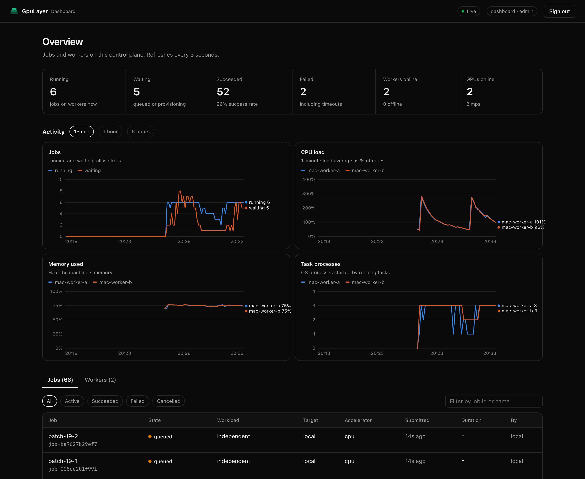

<p align="center">
  
</p>

<p align="center">
  <b>Run any workload on every GPU and CPU you can reach.</b><br>
  <a href="#install">Install</a> ·
  <a href="#quickstart">Quickstart</a> ·
  <a href="#for-ai-and-coding-agents">AI agents</a> ·
  <a href="#why-gpulayer">Why GPUlayer</a> ·
  <a href="#performance-and-comparison">Performance</a> ·
  <a href="#architecture">Architecture</a> ·
  <a href="https://www.gpulayer.dev/docs/">Docs</a> ·
  <a href="examples">Examples</a> ·
  <a href="CHANGELOG.md">Changelog</a>
</p>

GPUlayer sends a command, a Python function or a distributed job to machines that can run
it (this one, remote servers, clusters, data centers, cloud VMs, or several at once), starts
it there and brings back logs, outputs and results. PyTorch gets a deeper integration on top.
Documentation: [gpulayer.dev/docs](https://www.gpulayer.dev/docs/).

> **v0.2.0.** Tested on CPU, Apple Silicon (PyTorch MPS and MLX) and an
> NVIDIA Tesla T4, and across two machines on Google Cloud. Several GPUs per machine and NCCL
> across machines are implemented but not validated yet; cloud provisioning is simulated. See
> [Status and roadmap](docs/project/status.md).

## Install

```bash
curl -fsSL https://raw.githubusercontent.com/antonellof/gpulayer/main/install.sh | sh
gpulayer resources detect      # what this machine can run
```

Or with Docker (`docker build -t gpulayer .`, see [deploy/docker](deploy/docker)), or from
source to run the examples (`uv pip install -e '.[dev,examples]'`).
More in [Installation](docs/get-started/installation.md).

## Quickstart

```bash
# Any command as a job: code and inputs shipped, outputs returned
gpulayer submit --accelerator cuda --source ./app -- ./render.sh

# PyTorch: the same script in this process, as 2-process DDP, or on 2 nodes
python examples/trainer_regression/train.py
python examples/trainer_regression/train.py --accelerator cpu --devices 2
python examples/trainer_regression/train.py --accelerator cpu --nodes 2 --devices 2

# More machines: run this on the server, then paste the printed `gpulayer join` line elsewhere
gpulayer up

# See what ran
gpulayer dashboard
```

```python
import gpulayer as gl

@gl.remote(accelerator="mps", frameworks={"mlx": ">=0.10"})   # any library, any GPU
def benchmark(n: int) -> dict: ...

benchmark.map([1024, 2048, 4096])                           # in parallel
```



The [full quickstart](docs/get-started/quickstart.md) walks through each step with its output.

## For AI and coding agents

`gpulayer mcp` is an MCP server, so Claude Code, Claude Desktop, Cursor, Codex and VS Code
agents can list GPUs, submit jobs, wait, read logs and download outputs. An
[Agent Skill](integrations/skills/gpulayer/SKILL.md) covers agents that use the CLI.

```bash
claude mcp add gpulayer -- gpulayer mcp
```

See [AI and coding agents](docs/guides/ai-agents.md).

## Why GPUlayer

Most GPU code assumes the GPU is on the machine where you run it. With GPUlayer you describe
what a workload needs (an accelerator, GPU memory, frameworks) and it runs on a machine that
has it, wherever that machine is.

| Situation | Without GPUlayer | With GPUlayer |
|---|---|---|
| Code on a laptop, GPU elsewhere | ssh, copy code, rebuild the environment, tmux, copy results back | `gpulayer submit --target remote -- <cmd>` |
| Several GPU machines | track free machines by hand; jobs crash on the wrong GPU or library | one queue; each job lands where it can run, or is rejected with the reason |
| NVIDIA servers and Apple Silicon Macs | separate scripts and setup per machine | ask for `cuda` or `mps`; one interface |
| Many independent tasks | loops and ad hoc scripts | `fn.map([...])` across free GPUs |
| Multi-node training | `torchrun` on every node with matching ranks and addresses | `Trainer(num_nodes=2, devices=4)` |

On one machine with one GPU, running your code directly is simpler. GPUlayer runs jobs that
finish (long-running services are planned) and is not a sandbox for untrusted code. More in
[Why GPUlayer](https://www.gpulayer.dev/docs/#why-gpulayer).

## Performance and comparison

Measured on one NVIDIA Tesla T4 against PyTorch Lightning, with the same model, data and
optimizer:


- GPUlayer's Trainer is 1.3 to 1.4x faster per step on small models and the same on a
  compute-bound CNN, and starts about 0.6 s sooner.
- Distributed jobs start 1.1 to 2.3 s faster than through torchrun.
- Across two machines: a distributed job spanning both, fail-fast in 2.7 s, and 55.6 small
  jobs per second.

Method, all charts and raw logs:
[Performance and comparison](docs/get-started/performance-and-comparison.md). Reproduce them
with [`benchmarks/`](benchmarks/README.md).

## Architecture


GPUlayer has three parts:

- **Clients** submit work: the `gpulayer` CLI, the Python SDK (`@gl.remote`, `gl.Client`), the
  PyTorch `Trainer` and `launch()`, and the MCP server for AI agents. A job states what it
  needs (accelerator, GPU count and memory, frameworks), not which machine to use.
- **The control plane** keeps the job queue, picks a worker for each job and records the
  reason when no worker fits. It stores code bundles, inputs, outputs and logs, and checks
  tokens. For work on one machine it runs inside your process; for several machines it runs
  as a server (`gpulayer up`).
- **Workers**, one per machine, report their GPUs and installed frameworks, ask the control
  plane for tasks, run them as normal processes (one per rank for distributed jobs),
  stream logs back and upload outputs. Workers open every connection themselves, so they can
  sit behind NAT. A cloud VM is a worker that joined with `gpulayer join`.

A job goes from `queued` to `scheduled` when a worker fits, then `running`, and ends as
`succeeded`, `failed`, `cancelled` or `timed_out`. Frameworks such as PyTorch, JAX, MLX and
CuPy still decide how the computation uses the GPU; GPUlayer decides which GPU runs it. More in
[Architecture overview](docs/architecture/overview.md).

## Development

```bash
uv pip install -e '.[dev,examples]'
.venv/bin/pytest && .venv/bin/ruff check src tests && .venv/bin/mypy src
```

See [Contributing](docs/project/contributing.md). No license has been chosen yet
([ADR-0012](docs/decisions/ADR-0012-licensing-and-project-governance.md)); until one is added,
no rights are granted beyond viewing.
