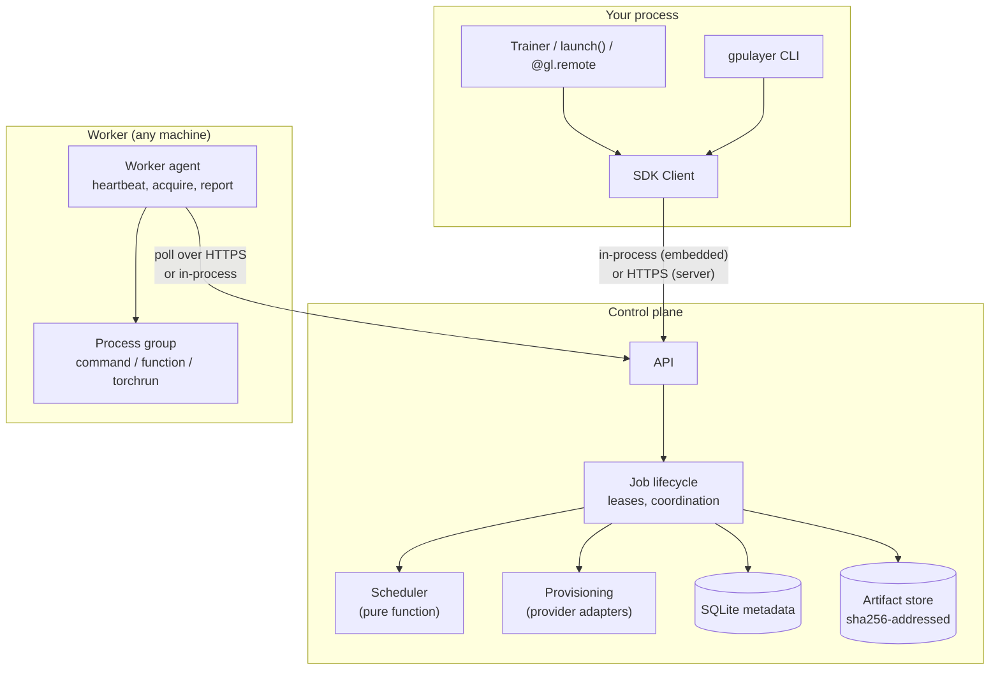

# Architecture overview

GpuLayer is a modular monolith. The components below live in one Python package and can run
in one process (embedded mode) or as a served control plane with remote workers.
See [ADR-0001](../decisions/ADR-0001-control-plane-and-deployment-model.md).

```
src/gpulayer/
├── contracts/models.py      versioned pydantic contracts (API_VERSION gpulayer.dev/v1alpha1)
├── control_plane/
│   ├── service.py           job lifecycle, worker registry, leases, coordination, reconcile
│   ├── scheduler.py         pure, deterministic, explainable placement
│   └── provisioning.py      provider-backed capacity: offers, bootstrap tokens, release
├── worker/
│   ├── agent.py             heartbeat / acquire / prepare / execute / report / clean up
│   └── channel.py           WorkerChannel protocol + in-process implementation
├── runtime/
│   ├── process.py           process-group execution, timeout, cancel, log streaming
│   ├── function_runner.py   stdlib-only runner for FunctionJob (copied into the workspace)
│   └── distributed.py       rank planning and torchrun argv construction
├── gpu/discovery.py         nvidia-smi, isolated torch probe (CUDA/MPS), rocm-smi
├── gpu/support.py           explicit support matrix consulted by the scheduler
├── providers/               ProviderAdapter interface, FakeProvider (simulated)
├── storage/sqlite.py        metadata store (jobs, tasks, workers, events, logs, instances, costs)
├── artifacts/store.py       content-addressed artifact store, deterministic source bundles
├── api/                     stdlib HTTP server, credentials, HTTP clients
├── sdk/                     Client, Job, builders, embedded control plane
└── cli/main.py              `gpulayer` CLI
```

## Components



Workers always initiate connections, so they can sit behind NAT. The scheduler has no I/O,
which keeps placement deterministic and testable.

## Data model

A job is one logical submission (`JobSpec`). Its states are
`queued → [provisioning] → scheduled → running → succeeded | failed | cancelled | timed_out`.
Validation happens synchronously at submission, and a retry moves the job back to `queued`.
The control plane rejects any transition not listed in `JOB_TRANSITIONS`
(`contracts/models.py`).

A task is one unit of work for one worker. An independent job has one task per attempt. A
distributed job has one task per node, and all of them are created in the same transaction when
the group is placed. Task states are `assigned → running → succeeded | failed | cancelled |
timed_out | lost`.

A worker record holds the reported `WorkerCapabilities`, a state derived from heartbeats
(`idle`, `busy`, `draining`, `offline`) and a session credential that can be revoked.

Events and log lines are append-only, numbered in sequence and queryable per job. Artifacts are
immutable bytes addressed by SHA-256 (`artifact://sha256/<hex>`).

Job state and worker state are tracked separately, so a worker can recover after its job has
failed.

## Request flow (independent job)

1. `submit` validates the spec, checks referenced artifacts exist, persists the job (`queued`).
2. A scheduling pass builds `WorkerView`s (capabilities + running tasks) and calls
   `scheduler.schedule()`. The decision (placed or not, with per-worker reasons) is stored.
3. Placement creates a task with a lease; the worker's next `acquire` returns it.
4. The worker calls `start`, stages the source bundle and inputs (verifying SHA-256), builds an
   allow-listed environment, resolves secret references locally, and runs the process group.
5. Logs are batched to the control plane with secret values redacted; heartbeats renew leases
   and deliver cancellation.
6. Output files are uploaded as artifacts; `finish` reports the outcome; the job resolves and a
   `JobResult` is persisted.

`reconcile()` (run by the server every second and opportunistically in embedded mode) expires
worker heartbeats and task leases, enforces a deadline backstop, and advances provisioning.

## Deployment shapes

| Shape | Control plane | Workers | Auth |
|---|---|---|---|
| Embedded (default) | in the SDK/CLI process, SQLite in `$GPULAYER_HOME` | in-process thread or `gpulayer worker start` sharing the same home | OS user owning `$GPULAYER_HOME` |
| Self-hosted | `gpulayer server start` (HTTP/HTTPS) | `gpulayer --url ... worker start` anywhere reachable | client token, join token, per-worker session token |
| Hosted | planned | | |

In self-hosted mode the network carries job specs, logs, events, artifacts (source bundles,
inputs and outputs) and worker capabilities. Job specs include `env` values, so pass secrets as
secret references; secret values stay on the workers. Nothing is sent to a GpuLayer-operated
service, and there is no telemetry.
