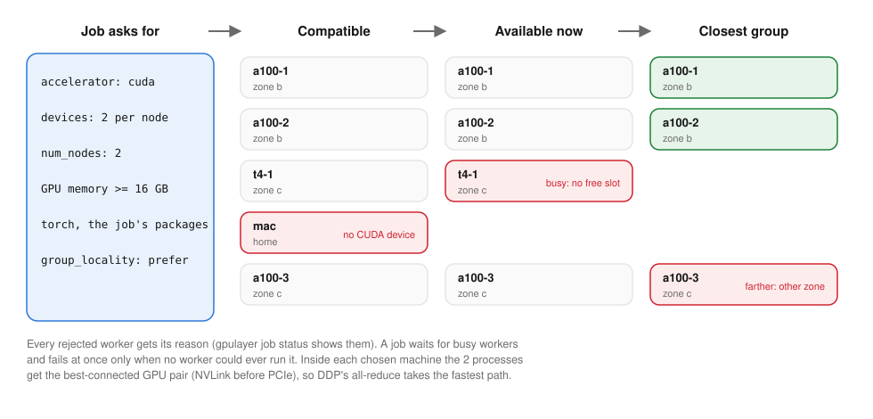

# Scheduling



## Scheduler (`control_plane/scheduler.py`)

`schedule(spec, workers, job_id) -> SchedulingDecision` is a pure function: no I/O, no provider
calls, no state changes.

1. It tries each allowed target in order (`placement.target`, then explicit `fallback_targets`).
2. For each worker, sorted by id, it computes `compatibility_reasons()`: target and origin,
   provider, region, labels, reservation, OS, CPU architecture, CPU, RAM, disk, Python,
   frameworks, the support matrix, and accelerator devices, memory and compute capability.
   Distributed jobs also check launcher, backend, torch and `advertise_address`.
3. Compatible workers are checked for availability (state and free task slots). If all are busy,
   the job waits. If none is compatible, the job fails at once when `on_unschedulable="fail"`.
4. Eligible workers are ranked by `first_fit` (worker id) or `most_free_memory`. The scheduler
   picks one worker, or for a distributed job a group sharing one torch version, kept as close
   together as possible (below).

The reasons for every candidate are stored on the job; `gpulayer job status` prints them.

## Distributed groups and network locality

Collectives run at the speed of the slowest link, so the scheduler keeps a group close together
([ADR-0021](../decisions/ADR-0021-topology-aware-group-placement.md)). Workers report:

| Level | Where it comes from |
|---|---|
| network group | the label `gpulayer.dev/network-group` (`--network-group rack-1`): a rack, LAN or switch you define |
| zone | GCE metadata on Google Cloud, the provider's record for workers GPUlayer created, or `--zone` / `$GPULAYER_ZONE` |
| region | the same sources, or `--region` / `$GPULAYER_REGION` |

`placement.group_locality`:

| Value | Behaviour |
|---|---|
| `prefer` (default) | the tightest group available now: one network group, else one zone, else one region, else any |
| `network_group`, `zone`, `region` | required; the job waits (or fails with `on_unschedulable="fail"` when it never could) until enough eligible workers share one |
| `any` | location ignored |

Within a level, workers are taken in policy rank order and the first location with enough of
them wins. `gpulayer job status` shows the choice, e.g.
`placed on worker group [...] (same zone europe-west1-b, ...)`. Workers with no location are
placed as before.

On Google Cloud, a 4-machine gloo training job split across two regions ran 16 to 24% slower
than in one region; two zones of one region were as fast as one zone. Placed by the scheduler,
the job took 42.5 s with `prefer` (one zone every time) and 58.8 s with `any` (two regions every
time), median of five
([Performance and comparison](../get-started/performance-and-comparison.md#one-distributed-job-in-one-region)).

```bash
gpulayer join https://server:8470 --token ... --zone dc1-row3 --network-group rack-7
gpulayer submit --distributed --nodes 8 --group-locality zone -- ...
```

From Python: `launch(..., group_locality="zone")`, `Trainer(..., launch_options={"group_locality": "zone"})`,
or `@gl.remote(..., group_locality="zone")`.

## GPUs inside a machine

Workers with several NVIDIA GPUs read the interconnect from `nvidia-smi topo -m`: NVLink
(`NV<n>`, n bonded links), one PCIe switch (`PIX`), several switches (`PXB`), the CPU's host
bridge (`PHB`), one NUMA node (`NODE`) or across sockets (`SYS`). A multi-GPU task gets the
free GPUs whose slowest link is fastest: a 4-GPU job on an 8-GPU NVLink machine takes one NVLink
island, a 2-GPU job on a two-socket PCIe box takes two GPUs behind one switch. Single-GPU tasks,
and machines with unknown topology, get the lowest-numbered free GPUs.

Tested with recorded `nvidia-smi topo -m` output and checked on real machines: on a 4× RTX 3070
server whose GPUs pair up behind two host bridges, a 2-GPU job with GPU 0 busy got GPUs 2 and 3
(`PHB`) instead of 1 and 2 (`SYS`); on a 2× A100 SXM4 the link was read as `NV4`.

## What is not scheduled on (yet)

- `cpu_cores` and `memory_gb` only constrain placement; nothing enforces them at runtime.
- Each worker runs up to `max_concurrent_tasks` tasks (default: one per usable NVIDIA or AMD
  GPU, at least 1; `--concurrency N` overrides). Each task gets its own GPUs through
  `CUDA_VISIBLE_DEVICES`. CPU jobs take a slot but no GPU. Apple Silicon Macs have one GPU, so
  they run one task at a time by default.
- Single-GPU tasks are not placed to keep NVLink islands free for later multi-GPU tasks.
- Distributed groups do not yet consider GPU interconnect inside each machine when choosing
  machines.
- Data locality and cost optimization are planned once reliable capability and pricing data
  exist. Cost data: [Cost accounting](cost-accounting.md).
