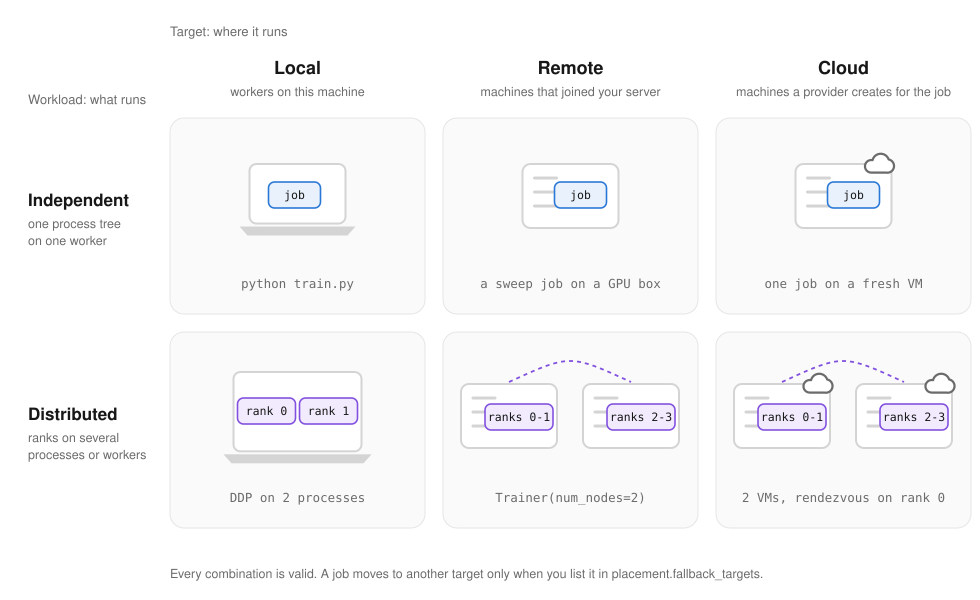
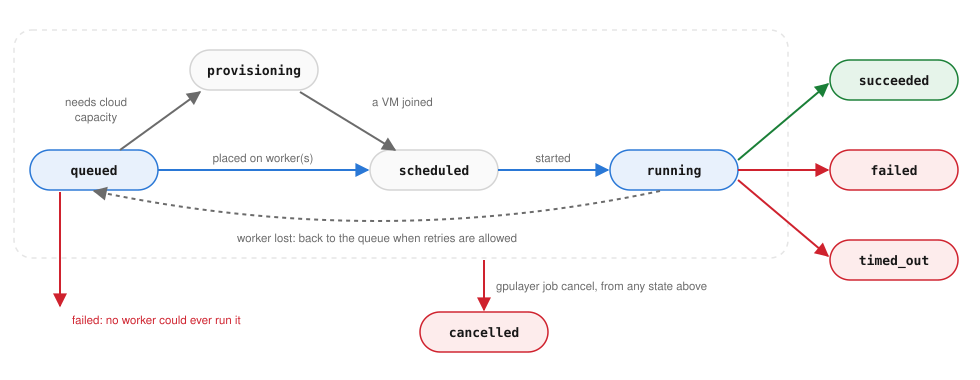

# Core concepts

## Jobs, targets and workload types

A job has a **target**, where it may run (`local`, `remote` or `cloud`), and a **workload
type**: `independent` (one worker) or `distributed` (one workload over several workers).



Every combination is valid. A job only moves to another target listed in
`placement.fallback_targets`.

## Workload kinds

| Kind | Type | What runs on the worker | Code packaging |
|---|---|---|---|
| `CommandJob` | independent | a command, inside the source bundle if one is given | optional source bundle |
| `FunctionJob` | independent | `module:function(*args, **kwargs)` | source bundle on `PYTHONPATH`, or an installed module |
| `DistributedJob` | distributed | one process per rank on every node, with the torchrun environment, running a script or `module:function` | source bundle |

Code travels as a zipped source directory, uploaded once. Function arguments and return values
must be JSON; closures, lambdas and pickles are not supported
([ADR-0002](../decisions/ADR-0002-job-contracts-and-packaging.md)). `@gl.remote` submits
`FunctionJob`s; the [Trainer](../pytorch/trainer.md) and `launch()` submit `CommandJob`s and
`DistributedJob`s.

## Workers

A worker registers with a control plane, reports its capabilities and runs tasks.

| Origin | Target | How it joins |
|---|---|---|
| `local` | `local` | started in your process by the SDK, or `gpulayer worker start` without `--url` |
| `existing` | `remote` | `gpulayer --url URL worker start` with a join token |
| `provider` | `cloud` | booted by a provider adapter with a single-use token |

Capabilities include OS, CPU, RAM, disk, Python, GPU frameworks, devices and their memory,
distributed backends and a reachable address. A worker can be compatible but busy.

## Placement

The scheduler records why each worker was rejected:

```text
scheduling: no eligible worker
  wkr-10c5089a6044: needs 1 usable cuda device(s), worker has 0
  wkr-471ad43b2467: torch 2.1.0 does not satisfy >=2.2
```

A job waits while its compatible workers are busy. With `on_unschedulable="fail"` (the default
for the CLI, `Trainer`, `launch()` and `@gl.remote`), a job no worker could run fails at once.
Distributed groups are kept in one network group, zone or region when possible, and multi-GPU
jobs get the best-connected GPUs. See [Scheduling](../architecture/scheduling.md).

## Job lifecycle



A job has one task per worker per attempt. A task is `lost` when its worker stops sending
heartbeats; the process may still run, so execution is not guaranteed exactly once.

## Control plane

The control plane holds the queue, the worker registry and the scheduler. By default it is
embedded in your process with SQLite in `$GPULAYER_HOME`. `gpulayer server start` runs a
self-hosted one over HTTPS; set `GPULAYER_URL` and `GPULAYER_TOKEN` to use it. The SDK, CLI
and PyTorch API work the same with both.
