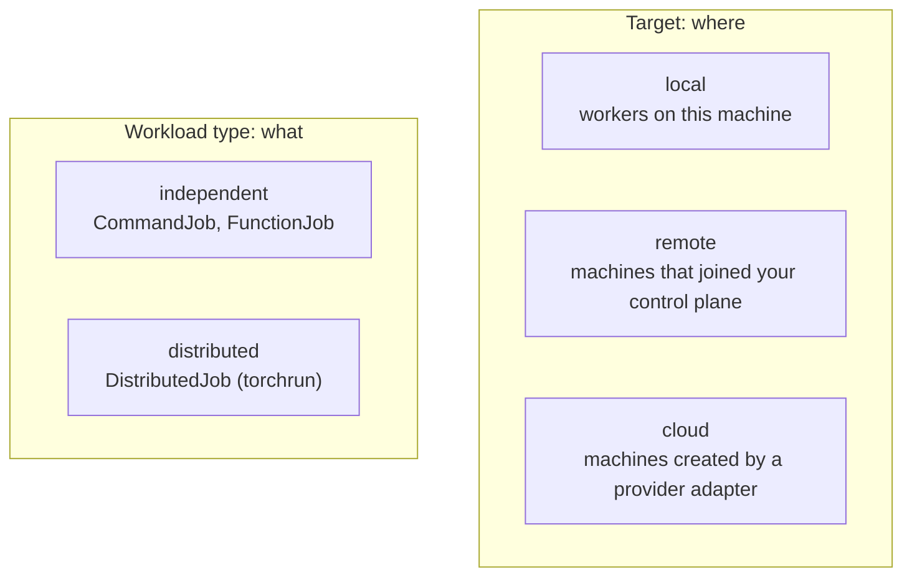
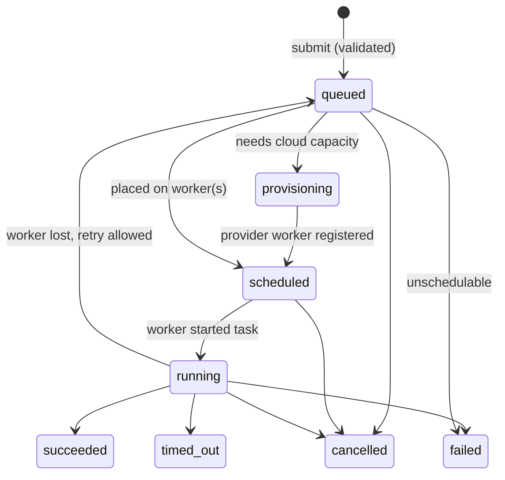

# Core concepts

## Jobs, targets and workload types

A job is one thing you asked GPUlayer to run. Two independent choices describe it:

- The **target** says where it may run: `local`, `remote` or `cloud`.
- The **workload type** says what runs: an `independent` job (one process tree on one worker)
  or a `distributed` job (one coordinated workload spread over several workers).



Any combination is valid. A distributed job can run on local workers, and a cloud job can be a
single process. A job runs on another target only when you list it in
`placement.fallback_targets`; a `local` job never moves to a remote machine on its own.

## Workload kinds

| Kind | Type | What runs on the worker | Code packaging |
|---|---|---|---|
| `CommandJob` | independent | a command, inside the source bundle if one is given | optional source bundle |
| `FunctionJob` | independent | `module:function(*args, **kwargs)` | source bundle on `PYTHONPATH`, or an installed module |
| `DistributedJob` | distributed | `torchrun` on every node, running a script or `module:function` | source bundle |

Code travels as source. GPUlayer zips the directory, uploads it once (addressed by its
SHA-256), and the worker imports your module by name. Function arguments and return values must
be JSON. Closures, lambdas and pickled objects are not supported, because they break across
machines, Python versions and trust boundaries ([ADR-0002](../decisions/ADR-0002-job-contracts-and-packaging.md)).

`@gl.remote` submits `FunctionJob`s for any Python library. The
[PyTorch integration](../pytorch/trainer.md) builds on the same kinds: `Trainer` and `launch()`
submit `CommandJob`s and `DistributedJob`s for you.

## Workers

A worker is a process that registers with a control plane, reports what it can do, and runs
tasks. Its origin decides which target it serves:

| Origin | Target | How it joins |
|---|---|---|
| `local` | `local` | started in your process by the SDK, or `gpulayer worker start` without `--url` |
| `existing` | `remote` | `gpulayer --url URL worker start` with a join token |
| `provider` | `cloud` | booted by a provider adapter with a single-use token |

Workers report **capabilities**: OS, CPU, RAM, disk, Python version, installed GPU frameworks
(PyTorch, JAX, MLX, CuPy, ...), accelerator
devices with their memory and compute capability, distributed backends, and the address peers
can reach. The scheduler also tracks **availability**: whether the worker is online and has a
free task slot. A worker can be compatible but busy, or free but incompatible.

## Placement

When a job is submitted, the scheduler checks every worker against the job's requirements and
records the reasons for each rejection:

```text
scheduling: no eligible worker
  wkr-10c5089a6044: needs 1 usable cuda device(s), worker has 0
  wkr-471ad43b2467: torch 2.1.0 does not satisfy >=2.2
```

A job whose compatible workers are all busy waits in the queue. A job that no registered worker
could ever run fails immediately when `on_unschedulable="fail"` (the default for the CLI,
`Trainer`, `launch()` and `@gl.remote`). See [Scheduling](../architecture/scheduling.md).

## Job lifecycle



Each job has one task per worker per attempt. Task states are `assigned`, `running`,
`succeeded`, `failed`, `cancelled`, `timed_out` and `lost`. A task becomes `lost` when its
worker stops sending heartbeats; the process may still be running, so GPUlayer never promises
exactly-once execution.

## Control plane

The control plane holds the queue, the worker registry and the scheduler. It runs in one of two
ways:

- **Embedded:** inside your Python process, backed by SQLite in `$GPULAYER_HOME`. This is the
  default and needs no server or account.
- **Self-hosted:** `gpulayer server start`, reachable over HTTPS by clients and remote workers.

The same SDK, CLI and PyTorch API work with both. Set `GPULAYER_URL` and `GPULAYER_TOKEN` to use
a self-hosted control plane.
