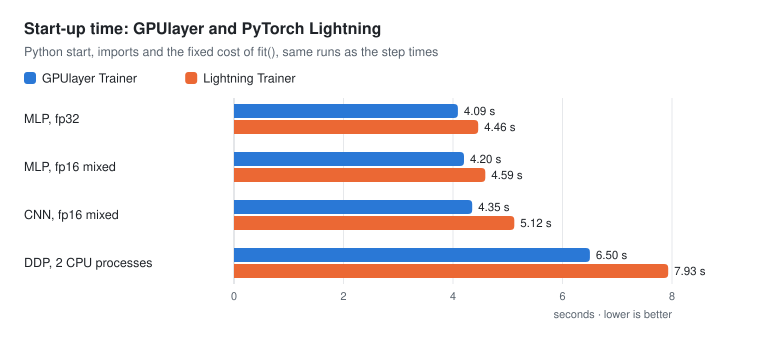
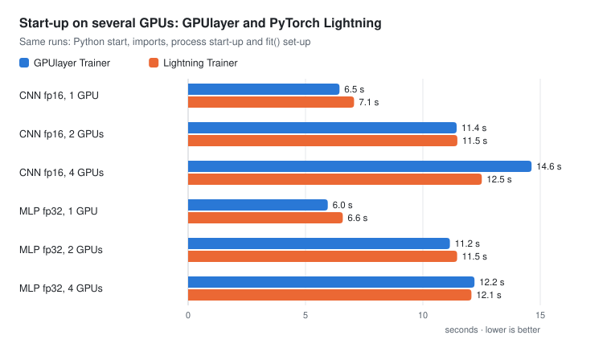

# Performance and comparison

Measured results for GPUlayer on NVIDIA GPUs and across machines, including side-by-side
comparisons with PyTorch Lightning.

## GPU results at a glance

| Hardware | What ran | Result |
|---|---|---|
| 1x Tesla T4 (AWS) | Trainer vs Lightning, MLP and CNN | GPUlayer Trainer 1.08 to 1.38x faster per step |
| 4x RTX 3070 (Vast.ai, PCIe) | Trainer vs Lightning on 1, 2 and 4 GPUs, DDP over NCCL | GPUlayer Trainer faster in 5 of 6 cases (1.26 to 1.60x), slower on the 1-GPU CNN (1.12x) |
| 2, 4 and 8 AWS machines, one T4 each | Trainer vs Lightning (torchrun), DDP over NCCL across machines | GPUlayer Trainer faster on the MLP (1.08 to 1.29x); Lightning faster on the CNN (1.01 to 1.09x) |
| 8 AWS machines, one T4 each | NCCL across machines: DDP with `sync_batchnorm`, manual optimization, FSDP | passed; identical weights on every rank |
| 4x RTX 3070 (Vast.ai) | NCCL all-reduce across 4 GPUs, best-connected GPU choice | passed; with GPU 0 busy a 2-GPU job got GPUs 2-3 (`PHB`) instead of 1-2 (`SYS`) |
| 2x A100 SXM4 (Vast.ai, NVLink) | NCCL all-reduce over NVLink, CUDA checks | passed; NVLink read as `NV4` |
| 1x T4, 1x RTX 3070, 1x A100 | Trainer in fp32, bf16, fp16, `torch.compile`, as a job | passed |
| Apple M2 Pro (Metal GPU and CPU) | Trainer vs Lightning, MLP and CNN on the GPU and the CPU, DDP on 2 CPU processes | GPUlayer Trainer faster in all 5 (1.02 to 1.80x) |

All comparisons on this page were measured on 2026-11-01 with the GPUlayer 0.8 Trainer (the
Lightning-parity loop of ADR-0024) and Lightning 2.6.6, each trainer with its defaults. Not
measured yet: GPUs with NVLink for training speed, and multi-GPU machines across the network.
Every number comes from a script in
[`benchmarks/`](https://github.com/antonellof/gpulayer/tree/main/benchmarks), and the raw logs
are in [`benchmarks/results/`](https://github.com/antonellof/gpulayer/tree/main/benchmarks/results).
Charts are generated from those logs by `scripts/make_perf_charts.py`.

## Training speed against PyTorch Lightning

The same model, data, optimizer and logged loss, trained with GPUlayer's `Trainer` and with
Lightning's `Trainer` on one Tesla T4.

| Case (Tesla T4) | GPUlayer Trainer, ms per step | Lightning, ms per step | Result |
|---|---|---|---|
| MLP, fp32, batch 256 | 3.58 | 4.94 | GPUlayer Trainer 1.38x faster |
| MLP, fp16 mixed precision | 4.22 | 5.57 | GPUlayer Trainer 1.32x faster |
| CNN, fp16 mixed precision, batch 128 | 11.14 | 12.07 | GPUlayer Trainer 1.08x faster |
| DDP, 2 CPU processes | 4.01 | 7.76 | GPUlayer Trainer 1.93x faster |

- **Small models** (the MLPs) take a few milliseconds per step, so the trainer's own work per
  step matters. GPUlayer's loop does less of it: it calls only the hooks that are overridden
  and does not wait for the GPU when a loss is logged.
- **The CNN** is dominated by GPU compute, so the trainers are closer. At 600 steps the
  GPUlayer Trainer's defaults leave cuDNN autotuning off (it turns on from 1,000 planned
  steps) and copy-ahead off, so both trainers run the same kernels the same way.
- **DDP on CPU** runs with each trainer's defaults on the same 4-vCPU machine. GPUlayer gives
  each process one CPU thread; Lightning leaves PyTorch's default, so its two processes
  compete for the cores. Much of the difference likely comes from that, not from the loop.

Start-up is Python start, imports and the fixed cost inside `fit()`. GPUlayer starts 0.4 to
1.4 s sooner in all four cases (4.1 to 6.5 s against 4.5 to 7.9 s).

**Method.** AWS `g4dn.xlarge` (4 vCPU Xeon Platinum 8259CL, one Tesla T4, driver 595, Spot),
Deep Learning Base OSS NVIDIA driver AMI (Ubuntu 22.04), Python 3.12, torch 2.15.0 with CUDA
13.2, Lightning 2.6.6, GPUlayer 0.8.0, run on 2026-11-01; every case on that machine. SGD with
momentum and one logged loss per step; Lightning runs without logger, progress bar, model
summary or checkpoints, GPUlayer without checkpoints. Each case runs 100 and 600 steps, three
times each in fresh processes, one run at a time with nothing else on the GPU. Milliseconds per
step is the difference of the median wall times divided by 500. Script:
`benchmarks/lightning_comparison/`. Logs: `benchmarks/results/2026-11-01-aws-t4/`; the
2026-10-31 run with the 0.7 Trainer on a GCP T4 is in `2026-10-31-gcp-t4/`.

These are single-GPU results with small models. Lightning still has features GPUlayer does not
(DeepSpeed, XLA, plugins); this compares speed only.

## Several GPUs in one machine against PyTorch Lightning

The same comparison on 1, 2 and 4 GPUs of one machine, DDP over NCCL, each trainer with its
defaults. The batch is per GPU (CNN 128 images in fp16, MLP 256 samples in fp32), so each step
trains on more samples as GPUs are added.

| Case (4x RTX 3070) | GPUlayer Trainer, ms per step | Lightning, ms per step | Result | Start-up, GPUlayer / Lightning |
|---|---|---|---|---|
| CNN fp16, 1 GPU | 14.49 | 12.99 | Lightning 1.12x faster | 6.5 s / 7.1 s |
| CNN fp16, 2 GPUs | 23.92 | 34.58 | GPUlayer Trainer 1.45x faster | 11.4 s / 11.5 s |
| CNN fp16, 4 GPUs | 37.21 | 56.08 | GPUlayer Trainer 1.51x faster | 14.6 s / 12.5 s |
| MLP fp32, 1 GPU | 5.59 | 7.04 | GPUlayer Trainer 1.26x faster | 6.0 s / 6.6 s |
| MLP fp32, 2 GPUs | 10.31 | 16.25 | GPUlayer Trainer 1.58x faster | 11.2 s / 11.5 s |
| MLP fp32, 4 GPUs | 18.05 | 28.80 | GPUlayer Trainer 1.60x faster | 12.2 s / 12.1 s |

- **The GPUlayer Trainer is faster in five of six cases, by 1.26 to 1.60x, and the lead grows
  with the number of GPUs.** On this machine the GPUs are unevenly connected (GPU 0 on one CPU
  socket, GPUs 1 to 3 on the other, 2 and 3 behind one PCIe switch). GPUlayer gives a 2-GPU
  job the best-connected pair (2 and 3) and each process its share of the CPU cores; the two
  contributions were not measured separately.
- **The 1-GPU CNN is 1.12x faster with Lightning on this host model**, as in the 2026-10-31 run
  (1.14x). Both run the same GPU kernels (profiled then: 777 vs 779 ms of CUDA time for 200
  steps); the step is limited by the CPU, and GPUlayer's CPU work runs about 10% slower here
  for a reason not found yet. On the T4 the same model is 1.08x faster with GPUlayer.
- **Start-up**: GPUlayer is faster in four of six cases; on 4 GPUs it is 2.1 s slower for the
  CNN and about equal for the MLP.
- **These hosts are noisy.** Repeated runs moved by up to 15%, so differences under that are
  not meaningful.

**Method.** Vast.ai `4x RTX 3070 8 GB`, Intel Xeon E5-2673 v4 (two sockets), Ubuntu 22.04,
Python 3.12, torch 2.15.0 with CUDA 13.2, Lightning 2.6.6, GPUlayer 0.8.0, run on 2026-11-01.
Script:
`benchmarks/lightning_comparison/` (cases `cnn-gpu1/2/4` and `mlp-gpu1/2/4`): 100 and 600
steps, three times each in fresh processes, interleaved; GPUlayer passes its loader as a
function, Lightning the loader. Logs: `benchmarks/results/2026-11-01-vast-4x3070-xeon/`; the
0.7 runs of 2026-10-31 are in `2026-10-31-vast-4x3070-xeon/` (same host model) and
`2026-10-31-vast-4x3070-multigpu/` (AMD EPYC 7551 host).

## Across machines with NCCL against PyTorch Lightning

One GPU per machine, DDP over NCCL across 2, 4 and 8 AWS machines. GPUlayer runs one
`Trainer(num_nodes=N, devices=1, target="remote")` call submitted to its server; Lightning runs
`Trainer(num_nodes=N, devices=1, strategy="ddp")` under torchrun, started on the same machines
at the same moment. The batch is per GPU, so each step trains on N times more samples.

| Case (g4dn.xlarge, 1x T4 each) | GPUlayer Trainer, ms per step | Lightning, ms per step | Result |
|---|---|---|---|
| CNN fp16, 2 machines | 19.12 | 17.58 | Lightning 1.09x faster |
| CNN fp16, 4 machines | 28.33 | 26.93 | Lightning 1.05x faster |
| CNN fp16, 8 machines | 43.94 | 43.69 | about equal (Lightning 1.01x) |
| MLP fp32, 2 machines | 23.74 | 30.72 | GPUlayer Trainer 1.29x faster |
| MLP fp32, 4 machines | 37.44 | 42.90 | GPUlayer Trainer 1.15x faster |
| MLP fp32, 8 machines | 52.21 | 56.28 | GPUlayer Trainer 1.08x faster |

- **The network sets the pace.** Both trainers use PyTorch's DDP over NCCL on TCP sockets (no
  EFA on these instances, "up to 25 Gbps"), so the gradient exchange dominates as machines are
  added and the trainers converge toward the same step time.
- **On the CNN, Lightning is ahead by 1 to 9%**, most on 2 machines, for a reason not found
  yet; the gap shrinks as communication grows. On the MLP, whose 5 M parameters make larger
  messages per unit of compute, the GPUlayer Trainer is ahead by 8 to 29%.
- GPUlayer starts every machine from one call and starts 0.6 to 1.3 s sooner in every case
  (7.2 to 8.6 s against 8.2 to 9.3 s).

**Method.** 8 AWS `g4dn.xlarge` Spot machines in one subnet (us-east-1c), driver 595, torch
2.15.0 with CUDA 13.2, Lightning 2.6.6, GPUlayer 0.8.0, 2026-11-01. A GPUlayer server on the
first machine; all eight joined as workers. `benchmarks/lightning_comparison/multinode.py`
(cases `cnn-gpu-nodes`, `mlp-gpu-nodes`): 100 and 600 steps, three times each, one run at a
time; ms per step as above, wall time measured on the server from start until the last process
exits. Logs: `benchmarks/results/2026-11-01-aws-8xt4-nccl/`. The same fleet validated
`sync_batchnorm`, manual optimization and FSDP over NCCL
([results](../../benchmarks/results/2026-11-01-aws-8xt4/README.md)).

## CPU and Apple GPU (M2 Pro)

The same comparison on an Apple M2 Pro, on its GPU (PyTorch MPS) and its CPU, fp32.

| Case (Apple M2 Pro) | GPUlayer Trainer, ms per step | Lightning, ms per step | Result | Start-up, GPUlayer / Lightning |
|---|---|---|---|---|
| MLP, CPU (batch 64) | 0.53 | 0.92 | GPUlayer Trainer 1.73x faster | 1.5 s / 1.6 s |
| CNN, CPU (batch 32) | 44.31 | 45.12 | GPUlayer Trainer 1.02x faster | 1.6 s / 1.8 s |
| DDP, 2 CPU processes | 2.28 | 4.09 | GPUlayer Trainer 1.80x faster | 2.7 s / 3.1 s |
| MLP, Apple GPU (batch 256) | 4.52 | 6.98 | GPUlayer Trainer 1.55x faster | 1.8 s / 1.9 s |
| CNN, Apple GPU (batch 128) | 24.34 | 25.08 | GPUlayer Trainer 1.03x faster | 1.9 s / 2.0 s |

- The gap is largest where the trainer's own work per step matters (the MLPs and DDP). On
  compute-heavy CNNs both are close to the hardware's speed (1.02 and 1.03x).
- Start-up is faster in every case.

**Method.** Apple M2 Pro (10 CPU cores, 32 GB), macOS, Python 3.12, torch 2.15.0, Lightning
2.6.6, GPUlayer 0.8.0, run on 2026-11-01 with nothing else running, same script and
measurement as above (`mlp-cpu`, `cnn-cpu`, `ddp-cpu-2`, `mlp-mps`, `cnn-mps`). Logs:
`benchmarks/results/2026-11-01-m2pro/`; the 0.7 run is in `2026-10-31-m2pro/`.

## Distributed job start-up

GPUlayer starts the processes of a distributed job itself by default, with the same
environment torchrun would set, instead of going through torchrun's elastic agent.

A trivial job (import torch, create the process group, one collective) with 2 nodes and 2
processes each, timed from submission until the client sees the result. The direct launcher
saves 1.1 to 2.3 s per job; the rest is mostly `import torch` in each process.

## Across machines

Two GCP VMs on one network: a server and two workers on an `n1-standard-8` with a T4, and a
third worker on an `e2-standard-8`, 15 job slots in total.

| Test | Result |
|---|---|
| CUDA job | placed on the T4 machine |
| A request no worker can satisfy | rejected with the reason |
| Distributed job across both machines (4 processes, gloo) | correct result; 2.43 s with the direct launcher, 4.73 s with torchrun |
| One process fails | both machines stopped within 2.7 s |

| Workload | Jobs | Wall clock | Task time added up | Jobs per worker (cpu8, t4-cpu, t4) |
|---|---|---|---|---|
| Tiny jobs, 0.02 s each | 500 | 9.0 s | 11.0 s | 243, 188, 69 |
| Data shards, 0.6 s each | 200 | 11.8 s | 127.8 s | 115, 72, 13 |
| Training runs (a learning-rate sweep) | 96 | 55.2 s | 241.7 s | 56, 34, 6 |

The tiny jobs measure GPUlayer's own overhead: 55.6 jobs per second across the two machines.
The training sweep reaches 4.4x parallelism on 15 slots, because each job also imports torch
(about 1.8 s on these VMs) and the `e2` machines' 8 vCPUs are 4 physical cores.

## One training job on more machines

The same training job (a CNN on 32,768 images, 2 epochs, global batch 256 split across all
processes) on 2, 4 and 8 AWS `g4dn.xlarge` machines (4 vCPU each, trained on the CPU), 4
processes per machine, gloo over the network. GPUlayer runs it with one `Trainer(num_nodes=N, devices=4)` call submitted to the
server; Lightning runs `Trainer(num_nodes=N, devices=4, strategy="ddp")` started with
torchrun on each machine, as its documentation describes.

| Machines | Processes | GPUlayer | Lightning | GPUlayer ahead by | Final loss (GPUlayer, Lightning) |
|---|---|---|---|---|---|
| 2 | 8 | 78.0 s | 78.9 s | 1.1% | 2.131, 2.130 |
| 4 | 16 | 47.1 s | 50.2 s | 6.2% | 2.141, 2.135 |
| 8 | 32 | 32.7 s | 39.8 s | 17.8% | 2.162, 2.174 |

- The GPUlayer Trainer trains 17.8% faster than Lightning on 8 machines. From 2 to 8 machines
  it gets 2.38x faster, Lightning 1.98x. (On GCP `n1-standard-4` machines with the 0.7
  Trainer, 2026-10-30, the lead on 8 machines was 11.9%; logs in
  `benchmarks/results/2026-10-30-gcp-two-level/`.)
- The lead comes from two-level gradient sync (ADR-0020), the Trainer's default with gloo
  when a job has several machines and several processes per machine: gradients are summed
  inside each machine before one all-reduce among the machines, so a step makes fewer network
  round trips. It grows with the number of machines and matters most for small models. NCCL
  jobs use PyTorch's DDP as is.
- GPUlayer starts all the machines from one `Trainer(num_nodes=N)` call; with Lightning you
  start torchrun on each machine, with matching ranks and addresses.
- The losses agree, so both trainers did the same work.
- With only 2 epochs, fixed costs (start-up, `import torch`, process-group setup) take a
  growing share as the training time falls. For GPUs over NCCL, see
  [Across machines with NCCL](#across-machines-with-nccl-against-pytorch-lightning).

Method: both trainers on the same machines (GPUlayer's job pinned with `worker_ids`), runs
alternating between the two, wall time from start until the last process exits, median of
three runs; GPUlayer 0.8.0, Lightning 2.6.6, torch 2.15.0, 2026-11-01. Scripts:
`benchmarks/lightning_comparison/scaling.py` and `scaling_run.py`; logs in
`benchmarks/results/2026-11-01-aws-8xt4-gloo/`.

## One distributed job in one region

The same 4-machine training job as above (4 processes per machine, gloo, two-level gradient
sync, 2 epochs) on 12 GCP `n1-standard-4` workers, all on Intel Skylake: 4 in
`europe-west1-b`, 4 in `europe-west1-c`, 4 in `europe-west4-a`. The machines were pinned to
each layout, runs alternated between layouts, median of five
(`benchmarks/lightning_comparison/locality_run.py`).

| Machines | Median | Compared with one zone |
|---|---|---|
| 4 in one zone (`europe-west1-b`) | 48.6 s | 1.00x |
| 4 in another zone (`europe-west1-c`) | 45.4 s | 0.93x |
| 2 + 2 in two zones of one region | 45.0 s | 0.93x |
| 2 + 2 in two regions (`europe-west1`, `europe-west4`) | 56.2 s | 1.16x |

- Splitting the job across two regions made it 16 to 24% slower than keeping it in one
  region.
- **Placed by the scheduler, not pinned:** the same job submitted with
  `group_locality="prefer"` (the default) and `"any"` (location ignored, the behaviour before
  0.6.0), alternating, five runs each. `prefer` put the group in one zone every time and took
  42.5 s (median); `any` split it across two regions every time and took 58.8 s. Keeping the
  group together made the job 1.38x faster (`policy-prefer-vs-any.log`).
- Two zones of one region cost nothing measurable: 45.0 s against 45.4 s for one of those
  zones alone. The gap between the two single-zone runs comes from the machines, not the
  network.
- Submitted without pinning, the scheduler put the job in one zone by itself (`placed on
  worker group [...] (same zone europe-west4-a, ...)`).
- The first run of each layout was 8 to 12 s slower (cold start) and is part of the median's
  five runs. Final losses were identical. Logs: `benchmarks/results/2026-10-31-gcp-locality/`
  (an earlier run on mixed Haswell and Skylake machines is kept there too).

## Thirty machines

One server and 30 workers (`n1-standard-4`, 4 slots each, 120 slots), 23 in Belgium
(`europe-west1`) and 7 in the Netherlands (`europe-west4`), created with
`benchmarks/cloud/gcp.sh` and tested with `benchmarks/scale_test.py`.

| Test | Result |
|---|---|
| 5,000 tiny jobs, 2,000 data shards, 480 training runs | all succeeded, spread over all 30 workers |
| Distributed job on 8 machines x 2 processes | correct; 4.3 s (direct launcher), 6.9 s (torchrun) |
| Distributed job on 16 machines x 2 processes | correct; 5.4 s (direct launcher), 8.1 s (torchrun) |
| One process fails in an 8-machine job | every machine stopped within 4.9 s |
| Worker processes killed on 3 machines during 600 jobs | 9 jobs retried on other machines, 0 failed |

Submitting 2,000 jobs on a separate run with 8 `n1-standard-4` workers (32 slots; logs in
`benchmarks/results/2026-10-30-gcp-9vm/`):

| Workload | Submitting | Total | Jobs per second |
|---|---|---|---|
| 2,000 tiny jobs, one request per job | 9.6 s | 24.1 s | 82.9 |
| 2,000 tiny jobs, `submit_batch` | 1.1 s | 21.6 s | 92.7 |
| 2,000 data shards (0.84 s each), `submit_batch` | 1.1 s | 60.2 s | 33.2 |

The workers set the limit, since each job starts a Python process. The shards ran 1,682 s of
work in 60 s on 32 slots, 87% of the ideal.

## What has not been measured

- Training speed on NVLink GPUs, multi-GPU machines across the network, and FSDP speed.
- Training that runs for hours, and more than 30 machines.
- AMD GPUs.

## Run the benchmarks yourself

See [`benchmarks/README.md`](https://github.com/antonellof/gpulayer/blob/main/benchmarks/README.md)
for running each benchmark locally, and `benchmarks/cloud/gcp.sh` for recreating these runs on
Google Cloud.
