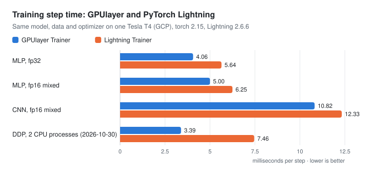
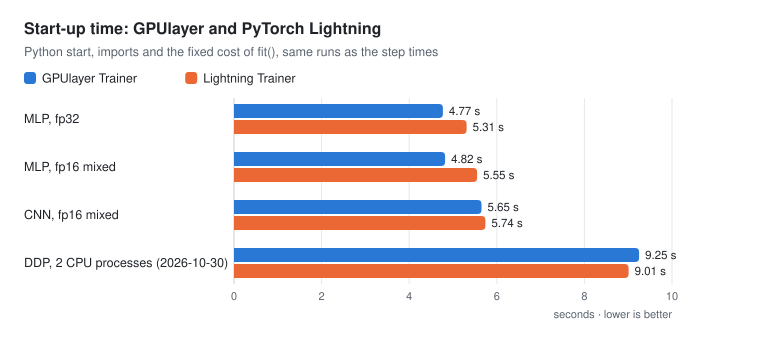
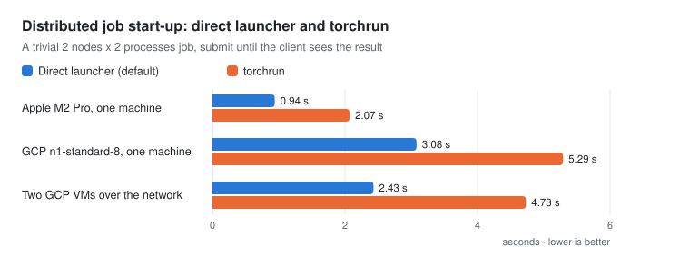
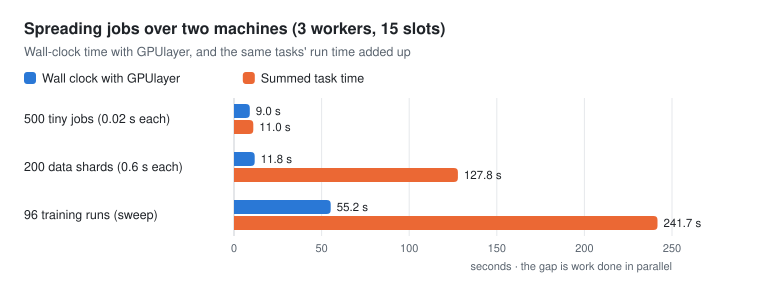
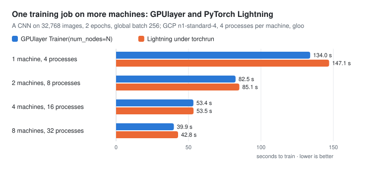

# Performance and comparison

Measured results for GPUlayer on an NVIDIA GPU and across machines, including a side-by-side
comparison with PyTorch Lightning. Every number comes from a script in
[`benchmarks/`](https://github.com/antonellof/gpulayer/tree/main/benchmarks), and the raw logs
are in [`benchmarks/results/`](https://github.com/antonellof/gpulayer/tree/main/benchmarks/results).
Charts are generated from those logs by `scripts/make_perf_charts.py`.

## Training speed against PyTorch Lightning

The same model, data, optimizer and logged loss, trained with GPUlayer's `Trainer` and with
Lightning's `Trainer` on one Tesla T4.

| Case (Tesla T4) | GPUlayer, ms per step | Lightning, ms per step | Result |
|---|---|---|---|
| MLP, fp32, batch 256 | 4.06 | 5.64 | GPUlayer 1.39x faster |
| MLP, fp16 mixed precision | 5.00 | 6.25 | GPUlayer 1.25x faster |
| CNN, fp16 mixed precision, batch 128 | 10.82 | 12.33 | GPUlayer 1.14x faster |
| DDP, 2 CPU processes (2026-10-30 run) | 3.39 | 7.46 | GPUlayer 2.20x faster |

- **Small models** (the MLPs) take a few milliseconds per step, so the trainer's own work per
  step matters. GPUlayer's loop does less of it, for example it does not wait for the GPU when
  a loss is logged.
- **The CNN** is dominated by GPU compute. GPUlayer turns on cuDNN autotuning by default
  (Lightning leaves it off) and copies the next batch to the GPU while the current step runs.
  Turning these off in the same session measured 12.67 ms per step (both off), 11.53 ms
  (autotuning only), 12.10 ms (copy-ahead only) and 10.93 ms (both). On the MLPs they made no
  difference beyond run-to-run variation (4.16 to 4.32 ms per step across the four
  variants). Logs: `benchmarks/results/2026-10-31-gcp-t4/`.
- **DDP on CPU** runs with each trainer's defaults. GPUlayer gives each process one CPU thread;
  Lightning leaves PyTorch's default, so its two processes compete for the 8 vCPUs. Much of
  the difference likely comes from that, not from the training loop.

Start-up is Python start, imports and the fixed cost inside `fit()`. GPUlayer starts 0.1 to
0.7 s sooner on one GPU, and 0.24 s later for DDP, where the job is packaged and scheduled
first.

**Method.** GCP `n1-standard-8` with one Tesla T4 (driver 580, Spot VM), Ubuntu 22.04,
Python 3.12, torch 2.15.0 with CUDA 13.2, Lightning 2.6.6, run on 2026-10-31 (the DDP row on
2026-10-30). SGD with momentum and one logged loss per step;
Lightning runs without logger, progress bar, model summary or checkpoints, GPUlayer without
checkpoints. Each case runs 100 and 600 steps, three times each in fresh processes, one run
at a time with nothing else on the GPU. Milliseconds per step is the difference of the median
wall times divided by 500. Script: `benchmarks/lightning_comparison/`.

These are single-GPU results with small models. Lightning has far more training features
(strategies such as FSDP and DeepSpeed, loggers, many callbacks); this compares speed only.

## Distributed job start-up

GPUlayer starts the processes of a distributed job itself by default, with the same
environment torchrun would set, instead of going through torchrun's elastic agent.

A trivial job (import torch, create the process group, one collective) with 2 nodes and 2
processes each, timed from submission until the client sees the result. The direct launcher
saves 1.1 to 2.3 s per job; the rest is mostly `import torch` in each process.

## Across machines

Two GCP VMs on one network: a server and two workers on an `n1-standard-8` with a T4, and a
third worker on an `e2-standard-8`, 15 job slots in total.

| Test | Result |
|---|---|
| CUDA job | placed on the T4 machine |
| A request no worker can satisfy | rejected with the reason |
| Distributed job across both machines (4 processes, gloo) | correct result; 2.43 s with the direct launcher, 4.73 s with torchrun |
| One process fails | both machines stopped within 2.7 s |

| Workload | Jobs | Wall clock | Task time added up | Jobs per worker (cpu8, t4-cpu, t4) |
|---|---|---|---|---|
| Tiny jobs, 0.02 s each | 500 | 9.0 s | 11.0 s | 243, 188, 69 |
| Data shards, 0.6 s each | 200 | 11.8 s | 127.8 s | 115, 72, 13 |
| Training runs (a learning-rate sweep) | 96 | 55.2 s | 241.7 s | 56, 34, 6 |

The tiny jobs measure GPUlayer's own overhead: 55.6 jobs per second across the two machines.
The training sweep reaches 4.4x parallelism on 15 slots, because each job also imports torch
(about 1.8 s on these VMs) and the `e2` machines' 8 vCPUs are 4 physical cores.

## One training job on more machines

The same training job (a CNN on 32,768 images, 2 epochs, global batch 256 split across all
processes) on 2, 4 and 8 GCP `n1-standard-4` machines, 4 processes per machine, gloo over
the network. GPUlayer runs it with one `Trainer(num_nodes=N, devices=4)` call submitted to the
server; Lightning runs `Trainer(num_nodes=N, devices=4, strategy="ddp")` started with
torchrun on each machine, as its documentation describes.

| Machines | Processes | GPUlayer | Lightning | GPUlayer ahead by | Final loss (GPUlayer, Lightning) |
|---|---|---|---|---|---|
| 2 | 8 | 118.9 s | 120.8 s | 1.6% | 2.129, 2.125 |
| 4 | 16 | 73.3 s | 77.4 s | 5.3% | 2.143, 2.137 |
| 8 | 32 | 50.5 s | 57.3 s | 11.9% | 2.162, 2.164 |

- GPUlayer trains 11.9% faster than Lightning on 8 machines. From 2 to 8 machines it gets
  2.35x faster, Lightning 2.11x.
- The lead comes from two-level gradient sync (ADR-0020), the Trainer's default with gloo
  when a job has several machines and several processes per machine: gradients are summed
  inside each machine before one all-reduce among the machines, so a step makes fewer network
  round trips. It grows with the number of machines and matters most for small models. NCCL
  jobs use PyTorch's DDP as is.
- GPUlayer starts all the machines from one `Trainer(num_nodes=N)` call; with Lightning you
  start torchrun on each machine, with matching ranks and addresses.
- The losses agree, so both trainers did the same work.
- With only 2 epochs, fixed costs (start-up, `import torch`, process-group setup) take a
  growing share as the training time falls. GPUs with NCCL were not measured.

Method: both trainers on the same machines (GPUlayer's job pinned with `worker_ids`), runs
alternating between the two, wall time from start until the last process exits, median of
three runs. Scripts: `benchmarks/lightning_comparison/scaling.py` and `scaling_run.py`; logs
in `benchmarks/results/2026-10-30-gcp-two-level/`.

## Thirty machines

One server and 30 workers (`n1-standard-4`, 4 slots each, 120 slots), 23 in Belgium
(`europe-west1`) and 7 in the Netherlands (`europe-west4`), created with
`benchmarks/cloud/gcp.sh` and tested with `benchmarks/scale_test.py`.

| Test | Result |
|---|---|
| 5,000 tiny jobs, 2,000 data shards, 480 training runs | all succeeded, spread over all 30 workers |
| Distributed job on 8 machines x 2 processes | correct; 4.3 s (direct launcher), 6.9 s (torchrun) |
| Distributed job on 16 machines x 2 processes | correct; 5.4 s (direct launcher), 8.1 s (torchrun) |
| One process fails in an 8-machine job | every machine stopped within 4.9 s |
| Worker processes killed on 3 machines during 600 jobs | 9 jobs retried on other machines, 0 failed |

Submitting 2,000 jobs on a separate run with 8 `n1-standard-4` workers (32 slots; logs in
`benchmarks/results/2026-10-30-gcp-9vm/`):

| Workload | Submitting | Total | Jobs per second |
|---|---|---|---|
| 2,000 tiny jobs, one request per job | 9.6 s | 24.1 s | 82.9 |
| 2,000 tiny jobs, `submit_batch` | 1.1 s | 21.6 s | 92.7 |
| 2,000 data shards (0.84 s each), `submit_batch` | 1.1 s | 60.2 s | 33.2 |

The workers set the limit, since each job starts a Python process. The shards ran 1,682 s of
work in 60 s on 32 slots, 87% of the ideal.

## What has not been measured

- More than one GPU per machine, NCCL across machines, and FSDP: the cloud project used had a
  quota of one GPU.
- Training that runs for hours, and more than 30 machines.
- AMD GPUs.

## Run the benchmarks yourself

See [`benchmarks/README.md`](https://github.com/antonellof/gpulayer/blob/main/benchmarks/README.md)
for running each benchmark locally, and `benchmarks/cloud/gcp.sh` for recreating these runs on
Google Cloud.
