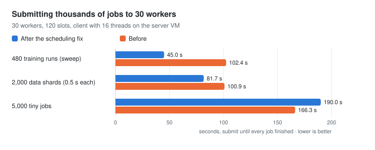

# Performance and comparison

Measured results for GPUlayer on an NVIDIA GPU and across machines, including a side-by-side
comparison with PyTorch Lightning. Every number comes from a script in
[`benchmarks/`](https://github.com/antonellof/gpulayer/tree/main/benchmarks), and the raw logs
are in [`benchmarks/results/`](https://github.com/antonellof/gpulayer/tree/main/benchmarks/results).
Charts are generated from those logs by `scripts/make_perf_charts.py`.

## Training speed against PyTorch Lightning

The same model, data, optimizer and logged loss, trained with GPUlayer's `Trainer` and with
Lightning's `Trainer` on one Tesla T4.

| Case (Tesla T4) | GPUlayer, ms per step | Lightning, ms per step | Result |
|---|---|---|---|
| MLP, fp32, batch 256 | 3.93 | 5.41 | GPUlayer 1.38x faster |
| MLP, fp16 mixed precision | 5.04 | 6.54 | GPUlayer 1.30x faster |
| CNN, fp16 mixed precision, batch 128 | 12.18 | 12.27 | about the same |
| DDP, 2 CPU processes | 3.39 | 7.46 | GPUlayer 2.20x faster |

- **Small models** (the MLPs) take a few milliseconds per step, so the trainer's own work per
  step matters. GPUlayer's loop does less of it, for example it does not wait for the GPU when
  a loss is logged.
- **The CNN** is dominated by GPU compute, and both trainers come out the same. Expect the
  same for most large models.
- **DDP on CPU** runs with each trainer's defaults. GPUlayer gives each process one CPU thread;
  Lightning leaves PyTorch's default, so its two processes compete for the 8 vCPUs. Much of
  the difference likely comes from that, not from the training loop.

Start-up is Python start, imports and the fixed cost inside `fit()`. GPUlayer starts 0.55 to
0.7 s sooner on one GPU, and 0.24 s later for DDP, where the job is packaged and scheduled
first.

**Method.** GCP `n1-standard-8` with one Tesla T4 (driver 580), Ubuntu 22.04, Python 3.12,
torch 2.15.0 with CUDA 13.2, Lightning 2.6.6. SGD with momentum and one logged loss per step;
Lightning runs without logger, progress bar, model summary or checkpoints, GPUlayer without
checkpoints. Each case runs 100 and 600 steps, three times each in fresh processes, one run
at a time with nothing else on the GPU. Milliseconds per step is the difference of the median
wall times divided by 500. Script: `benchmarks/lightning_comparison/`.

These are single-GPU results with small models. Lightning has far more training features
(strategies such as FSDP and DeepSpeed, loggers, many callbacks); this compares speed only.

## Distributed job start-up

GPUlayer starts the processes of a distributed job itself by default, with the same
environment torchrun would set, instead of going through torchrun's elastic agent.

A trivial job (import torch, create the process group, one collective) with 2 nodes and 2
processes each, timed from submission until the client sees the result. The direct launcher
saves 1.1 to 2.3 s per job; the rest is mostly `import torch` in each process.

## Across machines

Two GCP VMs on one network: a server and two workers on an `n1-standard-8` with a T4, and a
third worker on an `e2-standard-8`, 15 job slots in total.

| Test | Result |
|---|---|
| CUDA job | placed on the T4 machine |
| A request no worker can satisfy | rejected with the reason |
| Distributed job across both machines (4 processes, gloo) | correct result; 2.43 s with the direct launcher, 4.73 s with torchrun |
| One process fails | both machines stopped within 2.7 s |

| Workload | Jobs | Wall clock | Task time added up | Jobs per worker (cpu8, t4-cpu, t4) |
|---|---|---|---|---|
| Tiny jobs, 0.02 s each | 500 | 9.0 s | 11.0 s | 243, 188, 69 |
| Data shards, 0.6 s each | 200 | 11.8 s | 127.8 s | 115, 72, 13 |
| Training runs (a learning-rate sweep) | 96 | 55.2 s | 241.7 s | 56, 34, 6 |

The tiny jobs measure GPUlayer's own overhead: 55.6 jobs per second across the two machines.
The training sweep reaches 4.4x parallelism on 15 slots, because each job also imports torch
(about 1.8 s on these VMs) and the `e2` machines' 8 vCPUs are 4 physical cores.

## HTTP API

Running the tests above found that every request opened a new TLS connection, and that Linux
held each response for about 40 ms (Nagle's algorithm with delayed ACKs). After the fix
(kept-open connections, `TCP_NODELAY`):

| | before | after |
|---|---|---|
| One request on Linux, p50 (`benchmarks/http_requests.py`) | 43.0 ms | 0.60 ms |
| 500 tiny jobs over two machines | 7.8 jobs/s | 55.6 jobs/s |

## One training job on more machines

The same training job (a CNN on 32,768 images, 2 epochs, global batch 256 split across all
processes) on 1, 2, 4 and 8 GCP `n1-standard-4` machines, 4 processes per machine, gloo over
the network. GPUlayer runs it with one `Trainer(num_nodes=N, devices=4)` call submitted to the
server; Lightning runs `Trainer(num_nodes=N, devices=4, strategy="ddp")` started with
torchrun on each machine, as its documentation describes.

| Machines | Processes | GPUlayer | Lightning | GPUlayer speedup | Lightning speedup | Final loss (GPUlayer, Lightning) |
|---|---|---|---|---|---|---|
| 1 | 4 | 145.9 s | 145.8 s | 1.00x | 1.00x | 2.207, 2.204 |
| 2 | 8 | 83.0 s | 84.1 s | 1.76x | 1.73x | 2.210, 2.211 |
| 4 | 16 | 52.9 s | 53.3 s | 2.76x | 2.74x | 2.217, 2.212 |
| 8 | 32 | 40.5 s | 41.2 s | 3.60x | 3.54x | 2.227, 2.230 |

- Eight machines train the job 3.6x faster than one, with either trainer.
- Both train at the same speed, within 2% at every size. GPUlayer starts all the machines
  from one `Trainer(num_nodes=N)` call; with Lightning you start torchrun on each machine,
  with matching ranks and addresses.
- The losses agree, so both trainers did the same work.
- With only 2 epochs, fixed costs (start-up, `import torch`, process-group setup) and the
  gradient exchange over gloo on CPUs take a growing share as the training time falls. Longer
  training would scale closer to linear. GPUs with NCCL were not measured.

Method: both trainers on the same machines (GPUlayer's job pinned with `worker_ids`), runs
alternating between the two, wall time from start until the last process exits, median of
three runs. An earlier run without pinning put the two trainers on different VMs, and its results
swung by up to 9% either way, so it is not used here. Scripts: `benchmarks/lightning_comparison/scaling.py`
and `scaling_run.py`; logs in `benchmarks/results/2026-10-30-gcp-9vm/`.

### Two-level gradient sync

A profile of the 8-machine run (`benchmarks/lightning_comparison/profile_step.py`, 8 x 4
processes) showed where a step goes: 83 ms of compute, and 25.5 ms to all-reduce the
gradients over all 32 processes. Summing inside each machine first and then all-reducing
among the 8 machines took 11.0 ms for the same result, and a full DDP step went from 117 ms
to 102 ms. The Trainer now does this by default with gloo when a job has several machines and
several processes per machine (`gradient_sync="auto"`, ADR-0020); NCCL jobs are unchanged.

Rerun with the same method on a new set of 9 `n1-standard-4` VMs (GPUlayer with two-level
sync, Lightning with its default DDP; median of three, interleaved, same machines):

| Machines | Processes | GPUlayer | Lightning | GPUlayer ahead by |
|---|---|---|---|---|
| 2 | 8 | 118.9 s | 120.8 s | 1.6% |
| 4 | 16 | 73.3 s | 77.4 s | 5.3% |
| 8 | 32 | 50.5 s | 57.3 s | 11.9% |

The final losses agree (2.162 and 2.164 on 8 machines). These VMs were slower than the ones
in the table above for both trainers, so compare within a table, not across them. The lead
comes from fewer network round trips per step, so it grows with the number of machines and
matters most for small models; one machine is unaffected. Logs:
`benchmarks/results/2026-10-30-gcp-two-level/`.

## Thirty machines

One server and 30 workers (`n1-standard-4`, 4 slots each, 120 slots), 23 in Belgium
(`europe-west1`) and 7 in the Netherlands (`europe-west4`), created with
`benchmarks/cloud/gcp.sh` and tested with `benchmarks/scale_test.py`.

| Test | Result |
|---|---|
| 5,000 tiny jobs, 2,000 data shards, 480 training runs | all succeeded, spread over all 30 workers |
| Distributed job on 8 machines x 2 processes | correct; 4.3 s (direct launcher), 6.9 s (torchrun) |
| Distributed job on 16 machines x 2 processes | correct; 5.4 s (direct launcher), 8.1 s (torchrun) |
| One process fails in an 8-machine job | every machine stopped within 4.9 s |
| Worker processes killed on 3 machines during 600 jobs | 9 jobs retried on other machines, 0 failed |

Running these found three control-plane bottlenecks, now fixed: every submit re-scheduled the
whole queue (44 ms per submit at 2,000 queued, now 0.5 ms and flat), idle worker slots
re-checked the database five times a second, and each change woke every waiting slot.

The training sweep finished 2.3x sooner. Bursts of very short jobs stayed at about 25 jobs
per second, because the server is one Python process and used one CPU core at 100%. Three more
changes cut the server's work per job: a partial index for active tasks, HTTP connections
shared between a client's threads, and batch submission (`POST /v1/jobs/batch`). On a second
run with 8 workers (32 slots):

| Workload | Submitting | Total | Jobs per second |
|---|---|---|---|
| 2,000 tiny jobs, one request per job | 9.6 s | 24.1 s | 82.9 |
| 2,000 tiny jobs, `submit_batch` | 1.1 s | 21.6 s | 92.7 |
| 2,000 data shards (0.84 s each), `submit_batch` | 1.1 s | 60.2 s | 33.2 |

Now the workers set the limit, since each job starts a Python process. The shards ran 1,682 s of
work in 60 s on 32 slots, 87% of the ideal. These numbers come from a smaller fleet than the
first run, so they are not a direct before and after.

## What has not been measured

- More than one GPU per machine, NCCL across machines, and FSDP: the cloud project used had a
  quota of one GPU.
- Training that runs for hours, and more than 30 machines.
- AMD GPUs.

## Run the benchmarks yourself

See [`benchmarks/README.md`](https://github.com/antonellof/gpulayer/blob/main/benchmarks/README.md)
for running each benchmark locally, and `benchmarks/cloud/gcp.sh` for recreating these runs on
Google Cloud.
