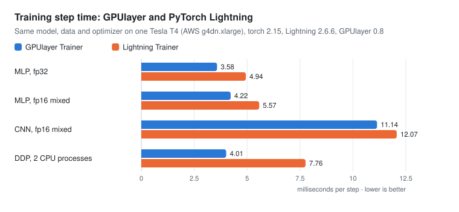
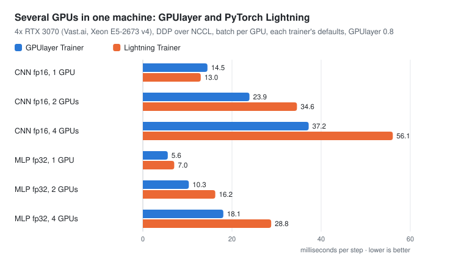
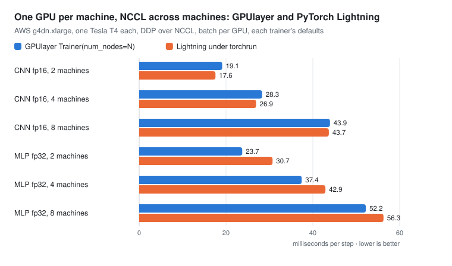
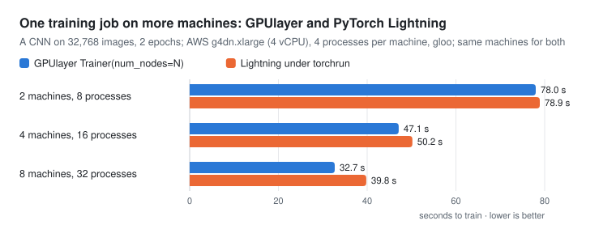
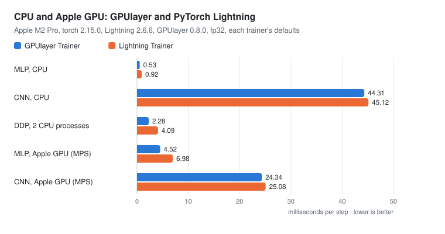
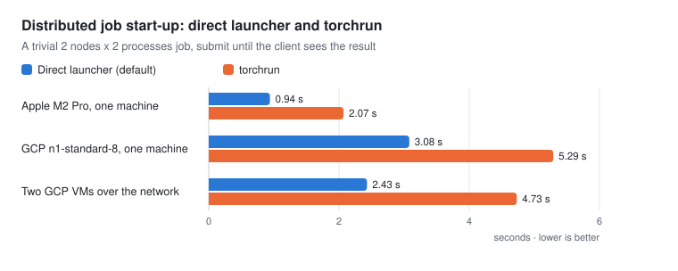
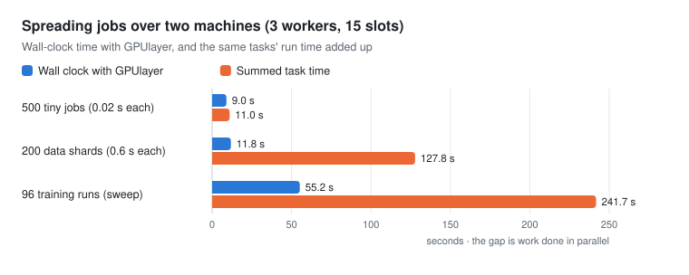
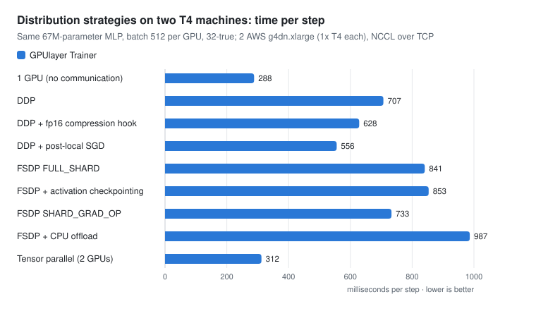
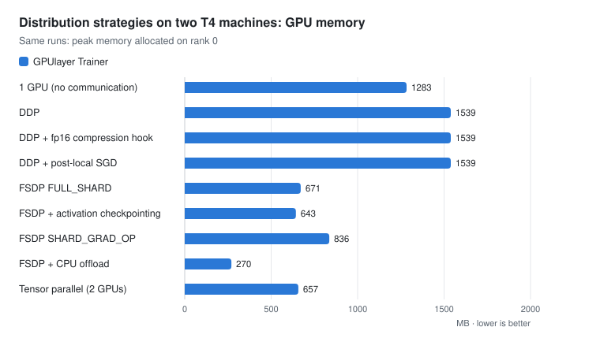

# Performance and comparison

Measured results for the GPUlayer Trainer against PyTorch Lightning, and for GPUlayer across
machines. Every number comes from a script in
[`benchmarks/`](https://github.com/antonellof/gpulayer/tree/main/benchmarks) with its logs in
[`benchmarks/results/`](https://github.com/antonellof/gpulayer/tree/main/benchmarks/results);
the charts are drawn from them by `scripts/make_perf_charts.py`.

| Hardware | GPUlayer Trainer against Lightning |
|---|---|
| 1x Tesla T4 (AWS) | 1.08 to 1.38x faster per step |
| 1, 2 and 4 RTX 3070s in one machine (NCCL) | 1.26 to 1.60x faster in 5 of 6 cases; 1.12x slower on the 1-GPU CNN |
| 2, 4 and 8 machines with one T4 each (NCCL) | MLP 1.08 to 1.29x faster; CNN 1.01 to 1.09x slower |
| 2, 4 and 8 CPU machines (gloo) | up to 17.8% faster (8 machines) |
| 1, 2 and 4 L4s in one machine (NCCL) | 1.04 to 1.68x faster in all 7 cases |
| 1 and 2 H200s (NVLink) | 1.10 to 2.50x faster in all 7 cases |
| Apple M2 Pro, GPU and CPU | 1.02 to 1.80x faster in all 5 cases |

**Method.** Same model, data, optimizer and logged loss in both trainers, each with its
defaults (GPUlayer 0.8.0, Lightning 2.6.6, torch 2.15.0, measured 2026-11-01). Lightning runs
without logger, progress bar, model summary or checkpoints, GPUlayer without checkpoints. Each
case runs 100 and 600 steps three times in fresh processes, one at a time with nothing else on
the GPU; ms per step is the difference of the median wall times divided by 500. Script:
`benchmarks/trainer_comparison/`.

## One GPU

| Case (Tesla T4, AWS `g4dn.xlarge`) | GPUlayer ms/step | Lightning ms/step | Result |
|---|---|---|---|
| MLP, fp32, batch 256 | 3.58 | 4.94 | GPUlayer 1.38x faster |
| MLP, fp16 mixed | 4.22 | 5.57 | GPUlayer 1.32x faster |
| CNN, fp16 mixed, batch 128 | 11.14 | 12.07 | GPUlayer 1.08x faster |
| DDP, 2 CPU processes | 4.01 | 7.76 | GPUlayer 1.93x faster |

The gap is largest on small models, where the trainer's own work per step counts: GPUlayer
calls only overridden hooks and does not wait for the GPU when a loss is logged. In the DDP
case GPUlayer gives each process one CPU thread while Lightning's two processes share the 4
vCPUs, which likely explains much of the difference. GPUlayer also starts 0.4 to 1.4 s sooner
([chart](../assets/perf/startup-light.svg)). Logs: `benchmarks/results/2026-11-01-aws-t4/`.

## Several GPUs in one machine

| Case (4x RTX 3070, Vast.ai) | GPUlayer ms/step | Lightning ms/step | Result |
|---|---|---|---|
| CNN fp16, 1 GPU | 14.49 | 12.99 | Lightning 1.12x faster |
| CNN fp16, 2 GPUs | 23.92 | 34.58 | GPUlayer 1.45x faster |
| CNN fp16, 4 GPUs | 37.21 | 56.08 | GPUlayer 1.51x faster |
| MLP fp32, 1 GPU | 5.59 | 7.04 | GPUlayer 1.26x faster |
| MLP fp32, 2 GPUs | 10.31 | 16.25 | GPUlayer 1.58x faster |
| MLP fp32, 4 GPUs | 18.05 | 28.80 | GPUlayer 1.60x faster |

The batch is per GPU, so each step trains on more samples as GPUs are added. GPUlayer gives a
2-GPU job the best-connected pair and each process its share of the CPU cores. On the 1-GPU CNN
both run the same GPU kernels; GPUlayer's CPU work is about 10% slower on this host for a reason
not found yet. These hosts are noisy (up to 15% between runs). Logs:
`benchmarks/results/2026-11-01-vast-4x3070-xeon/` ([start-up chart](../assets/perf/multigpu-startup-light.svg)).

## L4 and H200 GPUs

Measured 2026-11-09 on Hugging Face Jobs with GPUlayer 0.11.1 and the same method (Lightning
2.6.6, torch 2.15.0).

| Case | GPUlayer ms/step | Lightning ms/step | Result |
|---|---|---|---|
| L4: MLP fp32, 1 GPU | 3.58 | 3.72 | GPUlayer 1.04x faster |
| L4: MLP fp16, 1 GPU | 3.25 | 4.80 | GPUlayer 1.48x faster |
| L4: CNN fp16, 1 GPU | 6.40 | 6.91 | GPUlayer 1.08x faster |
| L4: MLP fp32, 2 GPUs | 7.30 | 11.12 | GPUlayer 1.52x faster |
| L4: MLP fp32, 4 GPUs | 10.24 | 15.67 | GPUlayer 1.53x faster |
| L4: CNN fp16, 2 GPUs | 9.14 | 14.20 | GPUlayer 1.55x faster |
| L4: CNN fp16, 4 GPUs | 13.40 | 22.45 | GPUlayer 1.68x faster |
| H200: MLP fp32, 1 GPU (two hosts) | 1.74; 2.30 | 4.36; 3.39 | GPUlayer 2.50x; 1.47x faster |
| H200: MLP fp16, 1 GPU | 2.95 | 3.36 | GPUlayer 1.14x faster |
| H200: CNN fp16, 1 GPU (two hosts) | 5.51; 5.20 | 6.06; 6.43 | GPUlayer 1.10x; 1.24x faster |
| 2 H200s (NVLink): MLP fp32 | 3.01 | 6.67 | GPUlayer 2.21x faster |
| 2 H200s (NVLink): CNN fp16 | 9.25 | 13.58 | GPUlayer 1.47x faster |

These models take a few milliseconds per step on an H200, so each trainer's CPU work per step
decides the result, and it varies by host: the same case gave 2.50x on one H200 host and 1.47x
on another. Small models, not a measure of large-model training. Logs and the parallel
strategies run on the same machines: [results](../../benchmarks/results/2026-11-09-hf-strategies-speed/README.md).

## Across machines with NCCL

| Case (AWS `g4dn.xlarge`, 1x T4 each) | GPUlayer ms/step | Lightning ms/step | Result |
|---|---|---|---|
| CNN fp16, 2 machines | 19.12 | 17.58 | Lightning 1.09x faster |
| CNN fp16, 4 machines | 28.33 | 26.93 | Lightning 1.05x faster |
| CNN fp16, 8 machines | 43.94 | 43.69 | about equal |
| MLP fp32, 2 machines | 23.74 | 30.72 | GPUlayer 1.29x faster |
| MLP fp32, 4 machines | 37.44 | 42.90 | GPUlayer 1.15x faster |
| MLP fp32, 8 machines | 52.21 | 56.28 | GPUlayer 1.08x faster |

GPUlayer runs one `Trainer(num_nodes=N)` call; Lightning runs under torchrun started on every
machine. Both use PyTorch's DDP over TCP (no EFA on these instances), so the gradient exchange
dominates as machines are added. Why Lightning is ahead on the CNN is not known yet. Logs:
`benchmarks/results/2026-11-01-aws-8xt4-nccl/`; the same fleet validated `sync_batchnorm`,
manual optimization and FSDP ([results](../../benchmarks/results/2026-11-01-aws-8xt4/README.md)).

## One training job on more machines

| Machines (4 processes each, gloo) | GPUlayer | Lightning | GPUlayer ahead by |
|---|---|---|---|
| 2 | 78.0 s | 78.9 s | 1.1% |
| 4 | 47.1 s | 50.2 s | 6.2% |
| 8 | 32.7 s | 39.8 s | 17.8% |

A CNN on 32,768 images for 2 epochs on AWS `g4dn.xlarge` CPUs, same machines for both, median
of three alternating runs; final losses agree. The lead comes from two-level gradient sync
([ADR-0020](../decisions/ADR-0020-two-level-gradient-sync.md)): with gloo and several
processes per machine, gradients are summed inside each machine before crossing the network.
Logs: `benchmarks/results/2026-11-01-aws-8xt4-gloo/`.

## CPU and Apple GPU (M2 Pro)

| Case (Apple M2 Pro) | GPUlayer ms/step | Lightning ms/step | Result |
|---|---|---|---|
| MLP, CPU | 0.53 | 0.92 | GPUlayer 1.73x faster |
| CNN, CPU | 44.31 | 45.12 | GPUlayer 1.02x faster |
| DDP, 2 CPU processes | 2.28 | 4.09 | GPUlayer 1.80x faster |
| MLP, Apple GPU (MPS) | 4.52 | 6.98 | GPUlayer 1.55x faster |
| CNN, Apple GPU (MPS) | 24.34 | 25.08 | GPUlayer 1.03x faster |

Logs: `benchmarks/results/2026-11-01-m2pro/`.

## Distributed job start-up

GPUlayer starts a distributed job's processes itself, with torchrun's environment, instead of
through torchrun's elastic agent. For a trivial 2 nodes x 2 processes job that saves 1.1 to 2.3
s from submission to result.

## One distributed job in one region

The same 4-machine gloo job on 12 GCP `n1-standard-4` workers in three zones of two regions,
median of five:

| Machines | Median | Against one zone |
|---|---|---|
| 4 in one zone | 48.6 s | 1.00x |
| 2 + 2 in two zones of one region | 45.0 s | 0.93x |
| 2 + 2 in two regions | 56.2 s | 1.16x |

Placed by the scheduler with `group_locality="prefer"` (the default), the group landed in one
zone every time and took 42.5 s; with `"any"` it was split across regions and took 58.8 s,
1.38x slower. Logs: `benchmarks/results/2026-10-31-gcp-locality/`.

## Scale

| Test | Result |
|---|---|
| 30 workers in two regions: 5,000 tiny jobs, 2,000 data shards, 480 training runs | all succeeded, spread over all workers |
| Distributed job on 16 machines x 2 processes | correct; 5.4 s (direct launcher), 8.1 s (torchrun) |
| One process fails in an 8-machine job | every machine stopped within 4.9 s |
| Workers killed on 3 machines during 600 jobs | 9 jobs retried elsewhere, 0 failed |
| 2,000 tiny jobs with `submit_batch` on 8 workers | 92.7 jobs per second |

Logs: `benchmarks/results/2026-10-30-gcp/`, `2026-10-30-gcp-9vm/` and `2026-10-30-gcp-fleet/`.

## Distribution strategies on two machines

One 67M-parameter MLP on two AWS `g4dn.xlarge` (one T4 each, NCCL over TCP), every
`strategy=` the Trainer offers. The data-parallel rows (DDP, FSDP) train 1,024 samples per step,
512 per GPU; tensor parallelism and the single GPU train 512, so compare memory across all rows
and time only within a group.

- On this network the gradient exchange dominates DDP: compressing it to fp16 saves 11% per
  step and post-local SGD (averaging every 4 steps) 21%.
- FSDP halves the memory per GPU; `SHARD_GRAD_OP` trades some of that back for 13% faster
  steps, and CPU offload keeps the parameters off the GPU (270 MB) for 17% slower steps.
- Tensor parallelism sends activations, not gradients: here it is the fastest way to use both
  GPUs for one batch, with half the memory per GPU.

Logs: `benchmarks/results/2026-11-01-aws-2xt4-parallel/` and `2026-11-01-aws-2xt4-ddp-hooks/`.
DeepSpeed ZeRO 1 to 3 on the same machines (a smaller model) is in
`2026-11-01-aws-2xt4-deepspeed/`.

## Not measured yet

- Training speed on NVLink GPUs and multi-GPU machines across the network; FSDP and tensor
  parallelism on large models and fast interconnects.
- Runs of several hours, more than 30 machines, AMD GPUs, FP8, TPUs.

To run the benchmarks yourself, see
[`benchmarks/README.md`](https://github.com/antonellof/gpulayer/blob/main/benchmarks/README.md).
