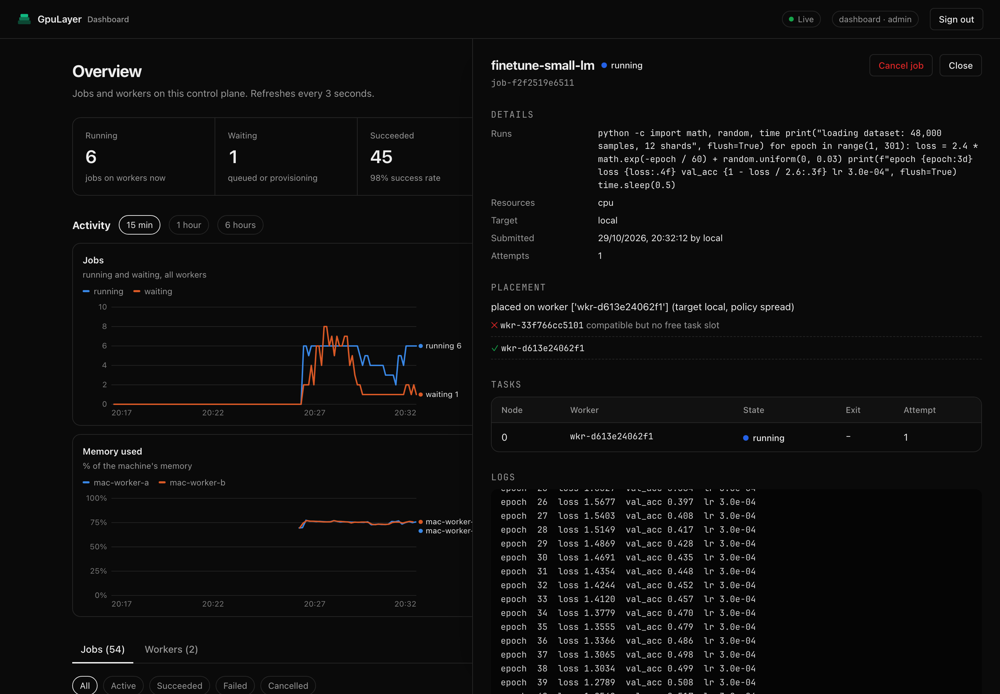
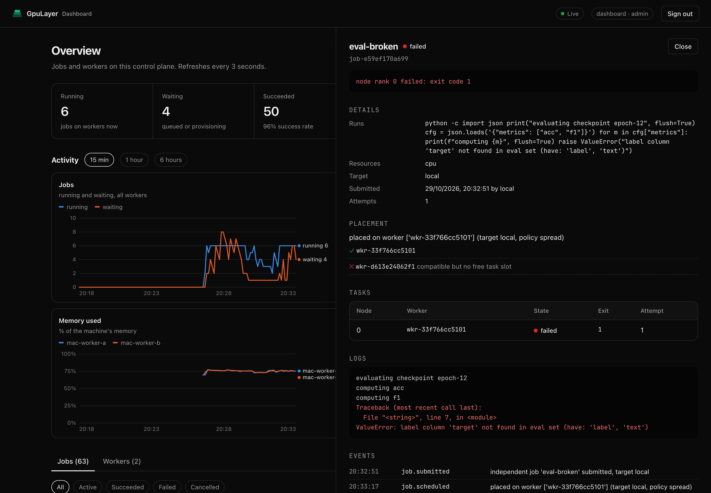
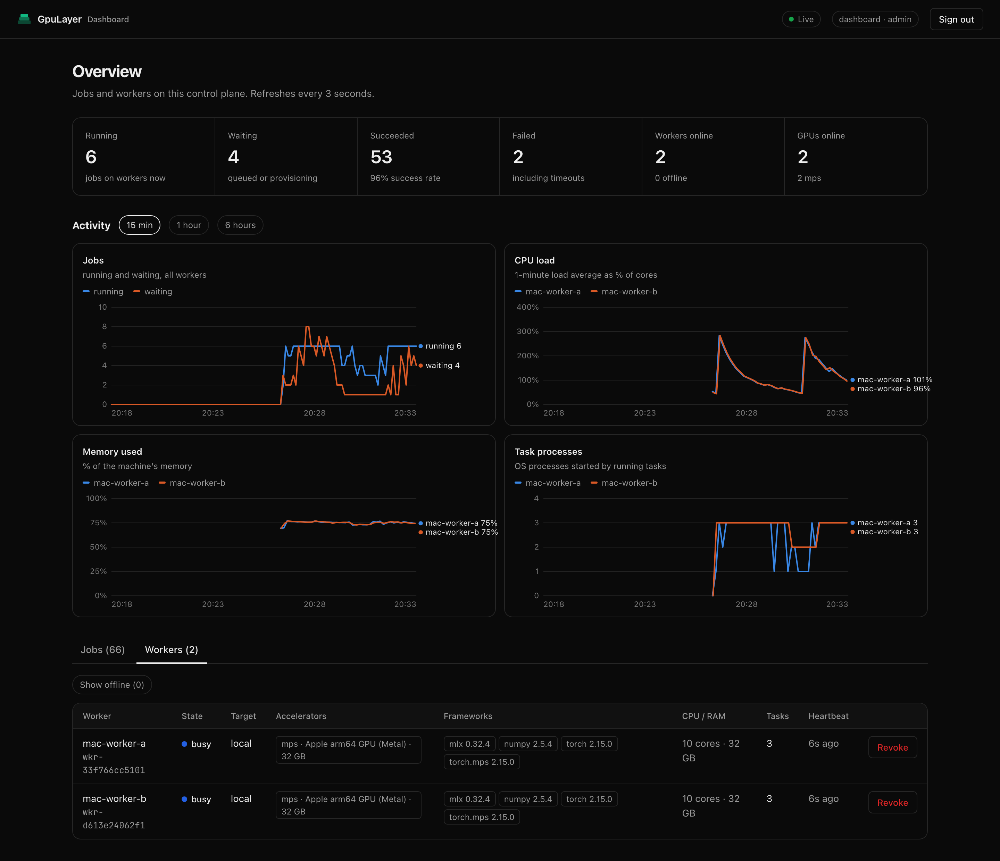

# Dashboard and monitoring

GpuLayer has a built-in web dashboard for day-to-day job management, and a Prometheus
`/metrics` endpoint for Grafana and alerting.

## Web dashboard

On a server started with `gpulayer up`, open `https://<server>:8470/ui/` and sign in with a
client token (`gpulayer up` prints one; `gpulayer token create alice --role submitter` makes
more). For local jobs, run:

```bash
gpulayer dashboard          # opens http://127.0.0.1:8471/ui/ already signed in
```


The dashboard shows:

- running, waiting, succeeded and failed jobs, workers online and GPUs online;
- activity charts over the last 15 minutes, hour or 6 hours: jobs running and waiting, CPU
  load, memory used and task processes per worker, and GPU utilisation on NVIDIA workers.
  Hover a chart to read every series at that moment;
- the jobs table, filterable by state and searchable by id or name;
- for each job: what it runs, its resources, why it was placed where it was (or why no worker
  qualified), its tasks per node, live logs, lifecycle events and the full JobSpec, plus a
  Cancel button for admins and for the job's submitter;
- workers with their GPUs, frameworks, CPU and memory, running tasks and last heartbeat, plus
  Revoke for admins. Offline workers are hidden until you ask for them.







Links can open a view directly: `/ui/?tab=workers`, `/ui/?range=15` (minutes: 15, 60 or 360)
and `/ui/?job=<job id>`.

It refreshes every 3 seconds (charts every 10 seconds) and uses the same API and permissions
as the CLI. Tokens stay in
the browser tab's session storage. Pages are served with a strict Content-Security-Policy, and
job output is always inserted as text, never as HTML.

## Worker telemetry

Every 10 seconds each worker sends a resource sample with its heartbeat: 1-minute load
average and core count, memory used and total, the number of OS processes belonging to its
running tasks, and on NVIDIA machines each GPU's utilisation and memory (from `nvidia-smi`).
Nothing needs extra privileges or packages. Apple GPU utilisation is not reported because
reading it requires root.

The control plane keeps one sample per worker every 5 seconds for 24 hours, in its own
database. Samples never leave your deployment. `GET /v1/metrics/history?minutes=60` returns
them with job activity for the dashboard; Prometheus gets the latest values as gauges.

## Prometheus metrics

`GET /metrics` returns the Prometheus text format. It needs a bearer token with the `metrics`,
`submitter` or `admin` role. A `metrics` token can read metrics and nothing else:

```bash
gpulayer token create prometheus --role metrics > prometheus-token
gpulayer metrics            # print the same text locally, embedded or against a server
```

| Metric | Type | Labels | Meaning |
|---|---|---|---|
| `gpulayer_jobs` | gauge | `state` | jobs in each state now |
| `gpulayer_tasks` | gauge | `state` | tasks assigned or running now |
| `gpulayer_workers` | gauge | `state`, `origin` | registered workers |
| `gpulayer_accelerators` | gauge | `accelerator` | usable GPUs on online workers |
| `gpulayer_queue_oldest_seconds` | gauge | | age of the oldest queued job |
| `gpulayer_jobs_submitted_total` | counter | `workload_type`, `target` | jobs submitted |
| `gpulayer_jobs_finished_total` | counter | `state` | jobs that finished, by final state |
| `gpulayer_tasks_lost_total` | counter | | tasks whose worker stopped heartbeating |
| `gpulayer_job_run_seconds` | histogram | `state` | first task start to end |
| `gpulayer_job_queue_wait_seconds` | histogram | `target` | submission to first start |
| `gpulayer_worker_load1` | gauge | `worker`, `worker_id` | 1-minute load average |
| `gpulayer_worker_cpu_count` | gauge | `worker`, `worker_id` | CPU cores |
| `gpulayer_worker_memory_used_bytes` / `_total_bytes` | gauge | `worker`, `worker_id` | memory |
| `gpulayer_worker_processes` | gauge | `worker`, `worker_id` | OS processes of running tasks |
| `gpulayer_worker_running_tasks` | gauge | `worker`, `worker_id` | tasks running |
| `gpulayer_gpu_utilization_ratio` | gauge | `worker`, `worker_id`, `gpu` | NVIDIA GPU utilisation, 0 to 1 |
| `gpulayer_gpu_memory_used_bytes` | gauge | `worker`, `worker_id`, `gpu` | NVIDIA GPU memory in use |
| `gpulayer_info` | gauge | `api_version` | always 1 |

Counters and histograms are stored in the metadata database, so they keep increasing across
restarts and `gpulayer gc`. Histogram buckets are 1 s, 5 s, 15 s, 1 min, 5 min, 15 min, 1 h,
4 h and 24 h.

## Grafana

[`deploy/monitoring/`](../../deploy/monitoring) has everything to run Prometheus and Grafana
next to a GpuLayer server:

```bash
cd deploy/monitoring
gpulayer token create prometheus --role metrics > gpulayer-token   # on the server machine
cp ~/.gpulayer/tls/cert.pem gpulayer-cert.pem                        # the server's certificate
# edit prometheus.yml: set the target to your server's address
docker compose up -d
```

Grafana runs on http://localhost:3001 with the **GpuLayer** dashboard provisioned. To use your
own Grafana instead, import [`grafana/gpulayer-dashboard.json`](../../deploy/monitoring/grafana/gpulayer-dashboard.json)
and pick your Prometheus data source. The dashboard shows running and waiting jobs, workers and
GPUs online, 24-hour success rate, the oldest queued job, jobs by state, throughput, run time
and queue wait (p50 and p95), workers by origin, GPUs by type, and lost tasks.

The metrics format has been checked with the official Prometheus client parser. The Compose
setup and Grafana dashboard follow the standard formats but have not been run against a live
Grafana in this repository yet.
