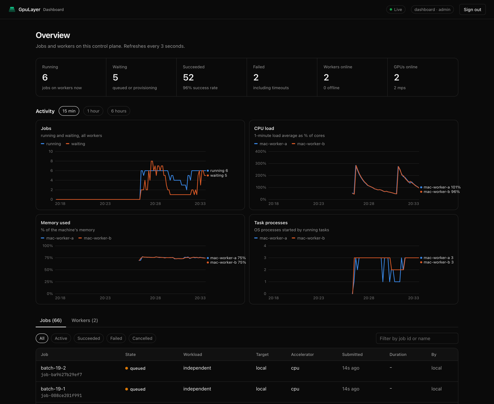
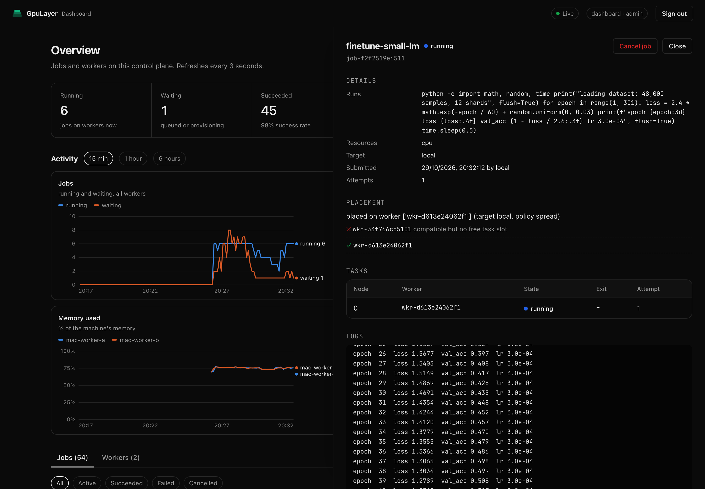
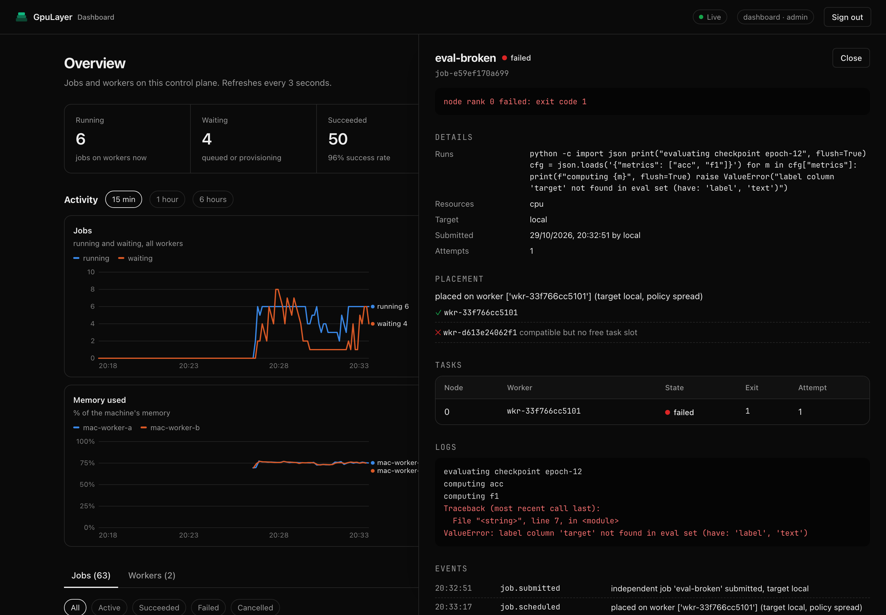
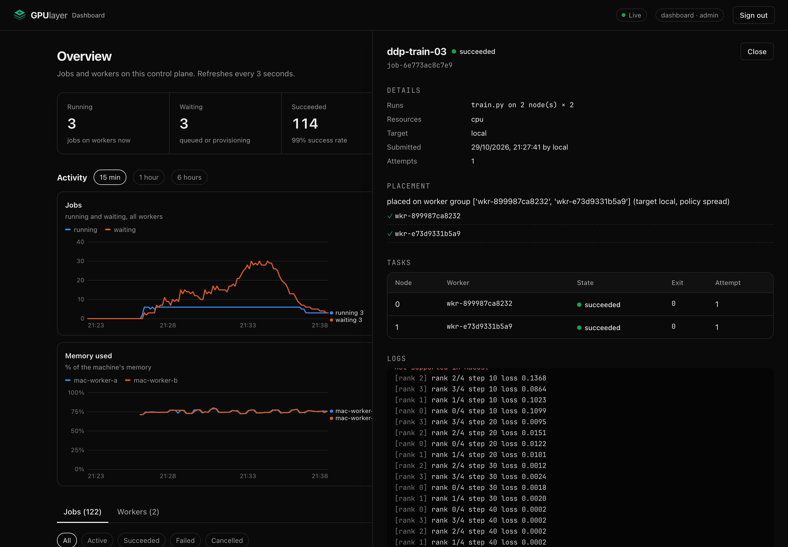
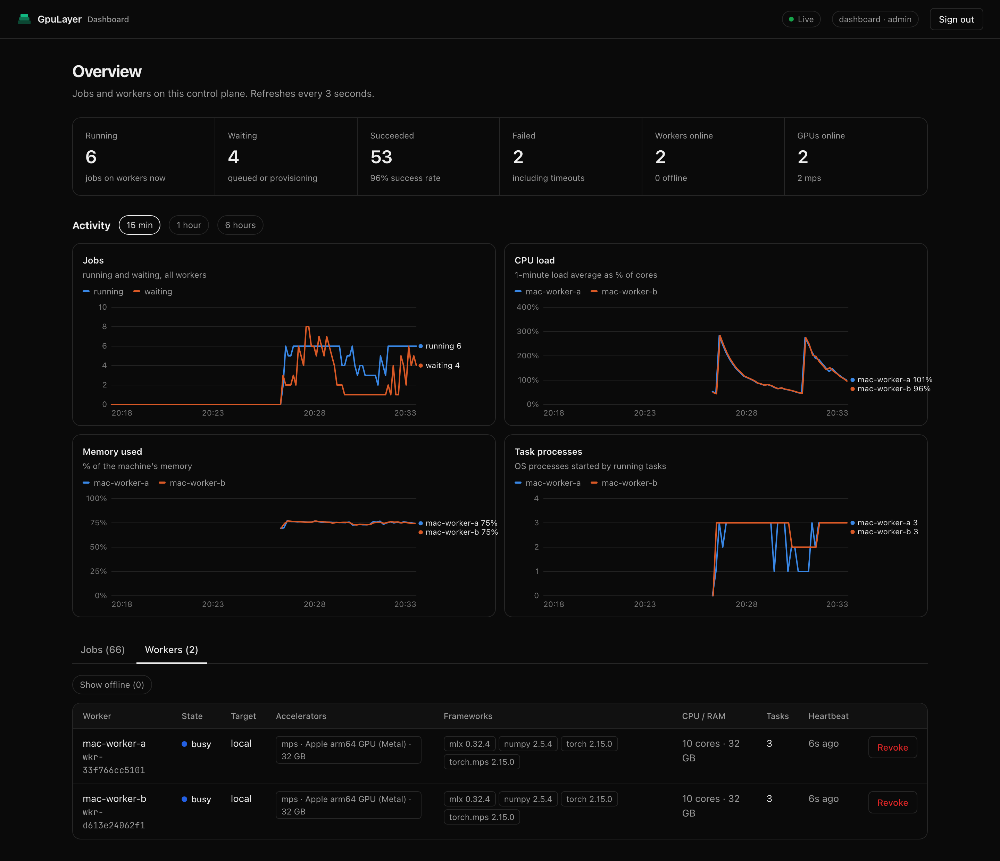

# Dashboard and monitoring

GPUlayer has a built-in web dashboard and a Prometheus `/metrics` endpoint.

## Web dashboard

On a server, open `https://<server>:8470/ui/` and sign in with a client token (`gpulayer up`
prints one; `gpulayer token create alice --role submitter` makes more). For local jobs:

```bash
gpulayer dashboard          # opens http://127.0.0.1:8471/ui/ already signed in
```



It shows jobs by state, workers and GPUs online, and charts for the last 15 minutes, hour or 6
hours (jobs running and waiting, per-worker CPU load, memory, task processes and NVIDIA GPU
utilisation). Each job shows its resources, why it was placed there or why no worker
qualified, tasks per node, live logs, events and the JobSpec. Admins and the submitter can
cancel a job; admins can revoke workers.









Direct links: `/ui/?tab=workers`, `/ui/?range=15` (minutes: 15, 60 or 360), `/ui/?job=<job id>`.
The page refreshes every 3 seconds (charts every 10) and uses the same API and permissions as
the CLI. Tokens stay in the tab's session storage, pages use a strict Content-Security-Policy,
and job output is inserted as text, never HTML.

## Worker telemetry

Every 10 seconds, with its heartbeat, each worker sends load average and core count, memory,
the OS processes of its tasks, and on NVIDIA machines each GPU's utilisation and memory (from
`nvidia-smi`). Apple GPU utilisation is not reported because it requires root. The control
plane keeps one sample per worker every 5 seconds for 24 hours in its own database
(`GET /v1/metrics/history?minutes=60`); samples never leave your deployment.

## Prometheus metrics

`GET /metrics` needs a `metrics`, `submitter` or `admin` token. A `metrics` token can read
nothing else.

```bash
gpulayer token create prometheus --role metrics > prometheus-token
gpulayer metrics            # print the same text locally, embedded or against a server
```

| Metric | Type | Labels | Meaning |
|---|---|---|---|
| `gpulayer_jobs` | gauge | `state` | jobs in each state |
| `gpulayer_tasks` | gauge | `state` | tasks assigned or running |
| `gpulayer_workers` | gauge | `state`, `origin` | registered workers |
| `gpulayer_accelerators` | gauge | `accelerator` | usable GPUs on online workers |
| `gpulayer_queue_oldest_seconds` | gauge | | age of the oldest queued job |
| `gpulayer_jobs_submitted_total` | counter | `workload_type`, `target` | jobs submitted |
| `gpulayer_jobs_finished_total` | counter | `state` | jobs finished, by final state |
| `gpulayer_tasks_lost_total` | counter | | tasks whose worker stopped heartbeating |
| `gpulayer_job_run_seconds` | histogram | `state` | first task start to end |
| `gpulayer_job_queue_wait_seconds` | histogram | `target` | submission to first start |
| `gpulayer_worker_load1`, `_cpu_count`, `_memory_used_bytes`, `_memory_total_bytes`, `_processes`, `_running_tasks` | gauge | `worker`, `worker_id` | per-worker load, cores, memory, task processes, running tasks |
| `gpulayer_gpu_utilization_ratio`, `gpulayer_gpu_memory_used_bytes` | gauge | `worker`, `worker_id`, `gpu` | NVIDIA GPU utilisation (0 to 1) and memory in use |
| `gpulayer_info` | gauge | `api_version` | always 1 |

Counters and histograms survive restarts and `gpulayer gc`. Histogram buckets: 1 s, 5 s, 15 s,
1 min, 5 min, 15 min, 1 h, 4 h, 24 h.

## Grafana

[`deploy/monitoring/`](../../deploy/monitoring) runs Prometheus and Grafana next to a server:

```bash
cd deploy/monitoring
gpulayer token create prometheus --role metrics > gpulayer-token   # on the server machine
cp ~/.gpulayer/tls/cert.pem gpulayer-cert.pem                        # the server's certificate
# edit prometheus.yml: set the target to your server's address
docker compose up -d
```

Grafana runs on http://localhost:3001 with the **GPUlayer** dashboard. For your own Grafana,
import [`grafana/gpulayer-dashboard.json`](../../deploy/monitoring/grafana/gpulayer-dashboard.json).

The metrics format has been checked with the official Prometheus client parser. The Compose
setup and Grafana dashboard have not been run against a live Grafana in this repository yet.
