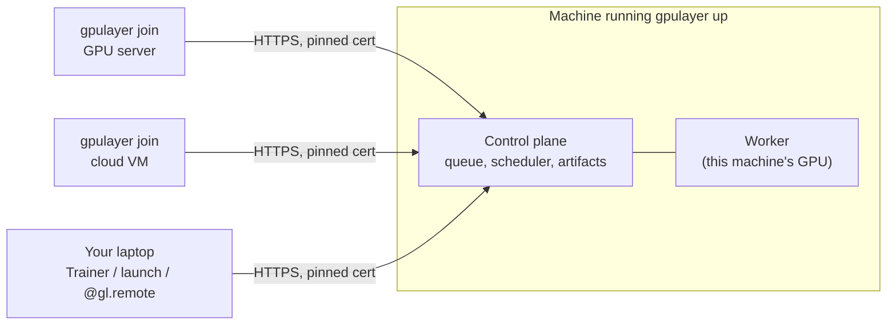

# Run a server (gpulayer up)

`gpulayer up` turns any machine into a GpuLayer server in one command. Other machines join it
with `gpulayer join`, and your code connects with `gl.connect` or two environment variables.



## 1. Start the server

On the machine that will coordinate (it can also have a GPU):

```bash
gpulayer up
```

```text
GpuLayer is up at https://192.168.1.56:8470  (TLS, self-signed certificate pinned by fingerprint)
Worker on this machine: gpu-box (cuda, 32 CPU cores)

Add a machine (GPU server, workstation, cloud VM) by running on it:
  gpulayer join https://192.168.1.56:8470 --token glj_... --fingerprint sha256:b2dc...

Use it from Python:
  import gpulayer as gl
  gl.connect("https://192.168.1.56:8470", token="glc_...", fingerprint="sha256:b2dc...")

Or from a shell:
  export GPULAYER_URL=https://192.168.1.56:8470 GPULAYER_TOKEN=glc_... GPULAYER_FINGERPRINT=sha256:b2dc...
```

What `up` does:

- starts the control plane on all interfaces, port 8470;
- creates a self-signed TLS certificate the first time and prints its fingerprint. Clients
  and workers pin that fingerprint, so there is no certificate file to copy and a
  man-in-the-middle cannot pose as the server;
- creates a client token and a join token, stored in `$GPULAYER_HOME/up-tokens.json`
  (mode 0600), and reuses them on restart;
- registers the machine itself as a worker (`--no-worker` to turn that off).

Useful flags: `--port`, `--advertise-address` (the address printed for others, when
auto-detection picks the wrong interface), `--python` (interpreter for jobs on this machine),
`--label pool=a100`, `--tls-cert/--tls-key` (your own certificate), `--insecure-http`
(plain HTTP, trusted networks only).

## 2. Add machines

Paste the `join` line on each machine that should run jobs:

```bash
gpulayer join https://192.168.1.56:8470 --token glj_... --fingerprint sha256:b2dc...
```

The machine reports its hardware (GPUs, memory, torch version, distributed backends) and starts
taking jobs that fit. Stop it with Ctrl+C; its running jobs are marked lost and handled by
their retry policy.

**Cloud VMs** work the same way: start a VM with a GPU image, install GpuLayer and PyTorch,
and run the `join` line. The VM must reach the server, so run `gpulayer up` somewhere both can
reach (a cloud VM with a public address, or a VPN). Automatic provisioning, where GpuLayer
creates the VMs itself, is not available yet; see [Cloud and providers](cloud-providers.md).

## 3. Use it

```python
import gpulayer as gl
import gpulayer.pytorch as glt

gl.connect("https://192.168.1.56:8470", token="glc_...", fingerprint="sha256:b2dc...")

trainer = glt.Trainer(max_epochs=10, accelerator="cuda", devices=2)
trainer.fit(model, train_loader, val_loader)       # runs on a worker with 2 GPUs
```

Or set the three environment variables and run scripts unchanged; `Trainer`, `launch()`,
`@gl.remote` and the CLI all pick them up. When connected to a server, jobs go to its workers
by default (`target="remote"`).

```bash
export GPULAYER_URL=... GPULAYER_TOKEN=... GPULAYER_FINGERPRINT=...
python examples/trainer_regression/train.py --accelerator cuda --devices 2
gpulayer worker status
gpulayer job list
```

## Multi-node training across machines

For `num_nodes > 1`, the nodes connect to each other directly for the collective operations.
Each worker must be reachable by the others at its advertised address
(`gpulayer join ... --advertise-address 10.0.0.21`), and firewalls must allow traffic between
workers. See [Distributed training](../pytorch/distributed.md).

## Security notes

- The client token can submit and cancel any job and revoke workers. Give it only to people
  you trust. The join token can only register workers.
- Workloads run as the user that started `gpulayer join`. Run workers under a dedicated user.
- See [Security and trust](../architecture/security.md) for the full model.

## Lower-level alternative

`gpulayer server init` + `gpulayer server start` + `gpulayer worker start --url ...` give the
same result with more control (your own certificates, separate state directories). See
[Remote workers](remote-workers.md).
