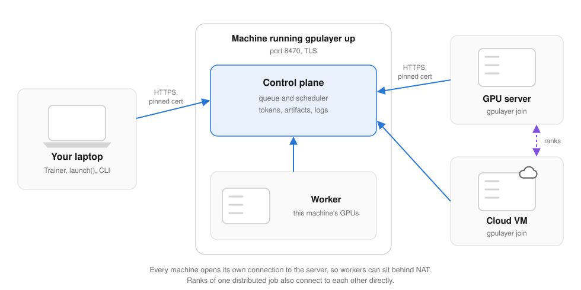

# Run a server (gpulayer up)

`gpulayer up` turns a machine into a GPUlayer server. Other machines join with `gpulayer join`.



## 1. Start the server

```bash
gpulayer up
```

```text
GPUlayer is up at https://192.168.1.56:8470  (TLS, self-signed certificate pinned by fingerprint)
Worker on this machine: gpu-box (cuda, 32 CPU cores)

Add a machine (GPU server, workstation, cloud VM) by running on it:
  gpulayer join https://192.168.1.56:8470 --token glj_... --fingerprint sha256:b2dc...

Use it from Python:
  import gpulayer as gl
  gl.connect("https://192.168.1.56:8470", token="glc_...", fingerprint="sha256:b2dc...")

Or from a shell:
  export GPULAYER_URL=https://192.168.1.56:8470 GPULAYER_TOKEN=glc_... GPULAYER_FINGERPRINT=sha256:b2dc...
```

`up` listens on all interfaces, port 8470, creates a self-signed certificate that clients pin by
fingerprint, stores a client and a join token in `$GPULAYER_HOME/up-tokens.json` (mode 0600,
reused on restart), and registers this machine as a worker (`--no-worker` to skip).

Flags: `--port`, `--advertise-address` (if the printed address is wrong), `--python`,
`--label pool=a100`, `--tls-cert/--tls-key`, `--insecure-http` (trusted networks only).

## 2. Add machines

Run the printed `join` line on each machine:

```bash
gpulayer join https://192.168.1.56:8470 --token glj_... --fingerprint sha256:b2dc...
```

The machine reports its hardware and takes jobs that fit. On Ctrl+C its running jobs are marked
lost and follow their retry policy. A cloud VM joins the same way if it can reach the server.
To have GPUlayer create VMs, see [Cloud and providers](cloud-providers.md).

## 3. Use it

```python
import gpulayer as gl
import gpulayer.pytorch as glt

gl.connect("https://192.168.1.56:8470", token="glc_...", fingerprint="sha256:b2dc...")

trainer = glt.Trainer(max_epochs=10, accelerator="cuda", devices=2)
trainer.fit(model, train_loader, val_loader)       # runs on a worker with 2 GPUs
```

Or set the environment variables and run scripts unchanged. `Trainer`, `launch()`, `@gl.remote`
and the CLI then send jobs to the server's workers (`target="remote"`).

```bash
export GPULAYER_URL=... GPULAYER_TOKEN=... GPULAYER_FINGERPRINT=...
python examples/trainer_regression/train.py --accelerator cuda --devices 2
gpulayer worker status
gpulayer job list
```

## Multi-node training across machines

With `num_nodes > 1`, workers connect to each other directly at their advertised addresses
(`gpulayer join ... --advertise-address 10.0.0.21`); firewalls must allow it. See
[Distributed training](../pytorch/distributed.md).

## Security notes

- The token printed by `up` is an admin token. Give people submitter tokens:
  `gpulayer token create alice --role submitter`.
- Use short-lived join tokens for new machines (`gpulayer token create vm-batch --role join --ttl 2h`)
  and revoke with `gpulayer token revoke <name>`.
- Jobs run as the user that started `gpulayer join`; use a dedicated user.

See [Security and trust](../architecture/security.md).

## Lower-level alternative

`gpulayer server init`, `server start` and `worker start --url ...` give more control (your own
certificates, separate state directories). See [Remote workers](remote-workers.md).
