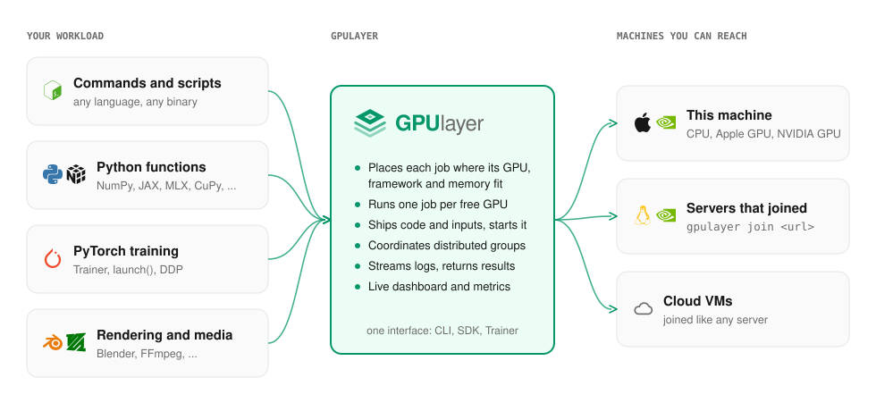

# GPUlayer

GPUlayer runs your workloads on every GPU you can reach: the one in your laptop, a workstation
down the hall, a rack of servers, or rented cloud VMs. A workload can be a command in any
language, a Python function using any library, or a distributed job across several machines.
GPUlayer finds a machine that can run it, starts it there, and brings back the logs, outputs and
results.

```bash
gpulayer submit --accelerator cuda --source ./app -- ./render.sh        # any command
```

```python
@gl.remote(accelerator="mps", frameworks={"mlx": ">=0.10"})             # any library
def benchmark(n: int) -> dict: ...

benchmark.map([1024, 2048, 4096])
```

```python
trainer = glt.Trainer(accelerator="cuda", devices=4, num_nodes=2, target="remote")
trainer.fit(model, train_loader)                                         # PyTorch integration
```

> **Status: v0.1.0, the first release.** Local execution, scheduling, the server and worker protocol, and
> distributed jobs on one host are implemented and tested, on CPU and Apple Silicon. NVIDIA GPUs
> and multi-machine runs are implemented but not validated yet, and automatic cloud
> provisioning is simulated. See [Status and roadmap](project/status.md).

## Where GPUlayer sits



Frameworks decide how a computation runs on the hardware they are given. GPUlayer decides which
hardware runs it, gets the code and data there, starts it, and returns the results. It works
under any framework, and adds a deeper integration for PyTorch training.

## What you can do with it

| You want to | With GPUlayer |
|---|---|
| Run a script on a GPU that is not in front of you | `gpulayer submit --target remote -- python infer.py` |
| Use one interface for NVIDIA boxes and Apple Silicon Macs | ask for `cuda` or `mps`; each job lands where that accelerator and its frameworks exist |
| Spread a batch of tasks over all free GPUs | `fn.map([...])` |
| Know why a job cannot run before it starts | a rejection reason per worker, e.g. `framework 'jax' not installed` |
| Train a model on 8 GPUs across two machines | `Trainer(devices=4, num_nodes=2)` or `launch(nodes=2, devices=4)` |
| Add a GPU machine to the pool | `gpulayer join <url> --token ...` |

## Where to go next

- [Quickstart](get-started/quickstart.md): commands, functions and training, from this machine to several
- [Why GPUlayer](get-started/why-gpulayer.md): what it adds, and when not to use it
- [Commands and scripts](workloads/commands.md), [Python functions](workloads/functions.md), [Any GPU framework](workloads/frameworks.md)
- [PyTorch integration](pytorch/trainer.md)
- [Run a server](guides/self-hosting.md): add more machines
