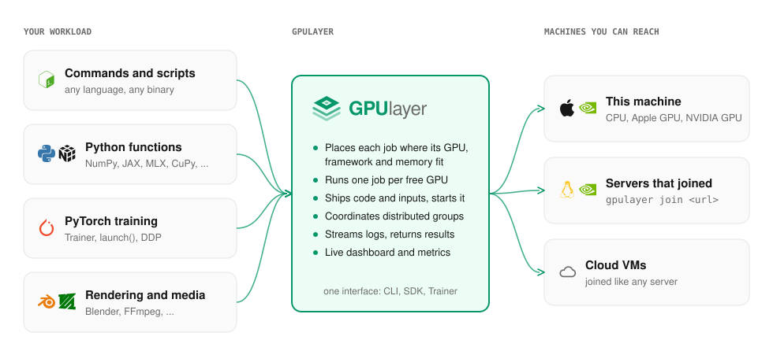

# GPUlayer

GPUlayer runs your workloads on every GPU and CPU you can reach: the ones in your laptop, remote
servers, clusters, data centers, or cloud VMs. A workload can be a command in any
language, a Python function using any library, or a distributed job across several machines.
GPUlayer finds a machine that can run it, starts it there, and brings back the logs, outputs and
results.

```bash
gpulayer submit --accelerator cuda --source ./app -- ./render.sh        # any command
```

```python
@gl.remote(accelerator="mps", frameworks={"mlx": ">=0.10"})             # any library
def benchmark(n: int) -> dict: ...

benchmark.map([1024, 2048, 4096])
```

```python
trainer = glt.Trainer(accelerator="cuda", devices=4, num_nodes=2, target="remote")
trainer.fit(model, train_loader)                                         # PyTorch integration
```

> **Status: v0.2.0.** Local execution, scheduling, the server and worker
> protocol, and distributed jobs are implemented and tested on CPU and Apple Silicon, and
> validated on an NVIDIA Tesla T4 and across two machines on Google Cloud. Several GPUs per
> machine and NCCL across machines are not validated yet, and automatic cloud provisioning is
> simulated. See [Status and roadmap](project/status.md) and
> [Performance and comparison](get-started/performance-and-comparison.md).

## Why GPUlayer

Most GPU code assumes the GPU is on the machine where you run it. GPU frameworks, from PyTorch
and its training libraries to JAX, MLX and CuPy, decide how a computation uses the hardware
they are given, inside the machine or cluster they were started on. Choosing that machine,
shipping code and data to it, starting the work, watching it and collecting the results is
left to you.

GPUlayer does that part. You describe what a workload needs (an accelerator, GPU memory,
frameworks), and it runs on a machine that has it, wherever that machine is. It does not
replace your framework, and it is not limited to training: rendering, inference batches,
simulations, data processing and benchmarks are all workloads. PyTorch gets an extra
integration (a Trainer, `launch()`, runtime helpers) because distributed training needs more
coordination than most workloads.

### When it helps

| Situation | Without GPUlayer | With GPUlayer |
|---|---|---|
| Code on a laptop, GPU somewhere else | ssh, copy code, rebuild the environment, run in tmux, copy results back | `gpulayer submit --target remote -- <cmd>`, or `python train.py --target remote` |
| Several GPU machines (team, lab, rented VMs) | track free machines by hand; jobs crash on the wrong GPU, driver or library version | one queue; each job lands where its accelerator and frameworks are available, or is rejected with the reason, e.g. `framework 'jax' not installed` |
| Mixed hardware (NVIDIA boxes and Apple Silicon Macs) | separate scripts and setup per machine | one interface; ask for `cuda` or `mps` and each job goes to a machine that has it |
| A batch of independent tasks (sweeps, rendering, data processing) | loops and ad hoc scripts | `fn.map([...])` in parallel across free GPUs |
| Multi-node training | `torchrun` on every node with matching ranks, addresses and ports | `Trainer(num_nodes=2, devices=4)` or `launch(nodes=2, devices=4)` |
| A new GPU machine | set it up by hand for each project | `gpulayer join <url> --token ...` adds it to the pool |

### A concrete example

You have a MacBook and a Linux box with two NVIDIA GPUs. Once, on the Linux box:

```bash
gpulayer up
```

Then, from the laptop, any of these runs on the box and streams its output back:

```bash
gpulayer submit --accelerator cuda --source ./video -- ./transcode.sh
python sweep.py                                  # @gl.remote(...).map([...]) over both GPUs
python train.py --accelerator cuda --devices 2   # PyTorch DDP on both GPUs
```

Outputs land in your current directory (`gpulayer_runs/<job-id>/`, or `gpulayer job result
--download`). The Mac itself can run MLX or PyTorch MPS jobs from the same queue.

## Architecture



GPUlayer has three parts:

- **Clients** submit work: the `gpulayer` CLI, the Python SDK (`@gl.remote`, `gl.Client`), the
  PyTorch `Trainer` and `launch()`, and the [MCP server](guides/ai-agents.md) for AI agents. A
  job states what it needs (accelerator, GPU count and memory, frameworks), not which machine
  to use.
- **The control plane** keeps the job queue, picks a worker for each job and records the
  reason when no worker fits ([Scheduling](architecture/scheduling.md)). It stores code
  bundles, inputs, outputs and logs, and checks tokens. For work on one machine it runs inside
  your process; for several machines it runs as a server (`gpulayer up`).
- **Workers**, one per machine, report their GPUs and installed frameworks, ask the control
  plane for tasks, run them as normal processes (one per rank for
  [distributed jobs](architecture/distributed.md)), stream logs back and upload outputs.
  Workers open every connection themselves, so they can sit behind NAT. A cloud VM is a
  worker that joined with `gpulayer join`.

A job goes from `queued` to `scheduled` when a worker fits, then `running`, and ends as
`succeeded`, `failed`, `cancelled` or `timed_out`. Frameworks still decide how a computation
runs on the hardware they are given; GPUlayer decides which hardware runs it. It works under
any framework, and adds a deeper integration for PyTorch training. The
[Architecture overview](architecture/overview.md) covers the components, data model and request
flow in detail.

## When not to use it

- **One machine, one GPU, interactive work.** Running your code directly is simpler. GPUlayer
  adds a control plane, workers and tokens you do not need.
- **Long-running services.** An inference server that must stay up and accept traffic is not
  supported yet; GPUlayer runs jobs that finish.
- **Untrusted users.** Workloads run as normal processes on workers, not in a sandbox. Use
  GPUlayer among people who trust each other.
- **Validated scale today.** GPUlayer is at v0.2.0. It has been validated
  on one NVIDIA GPU and on two machines; several GPUs per machine and NCCL across machines are
  not validated yet, distributed jobs support PyTorch only, and automatic cloud provisioning is simulated. Cloud VMs you start yourself can join
  with `gpulayer join`.

Two constraints: function arguments and results must be JSON, and code ships as files (the
directory of your script), not as pickled Python objects.

## Where to go next

- [Quickstart](get-started/quickstart.md): commands, functions and training, from this machine to several
- [Performance and comparison](get-started/performance-and-comparison.md): measured results, including PyTorch Lightning
- [Commands and scripts](workloads/commands.md), [Python functions](workloads/functions.md), [Any GPU framework](workloads/frameworks.md)
- [PyTorch integration](pytorch/trainer.md)
- [Run a server](guides/self-hosting.md): add more machines
