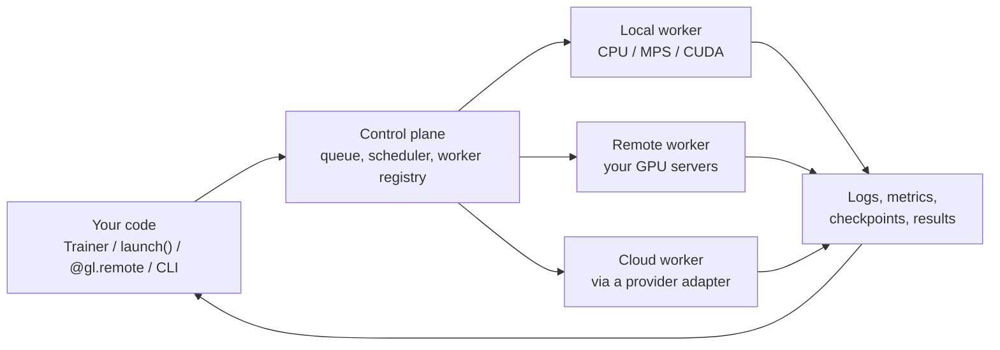

# GpuLayer

GpuLayer runs PyTorch code on whatever compute you can reach: the GPU in your laptop, a
workstation down the hall, a rented cloud machine, or several of them at once. You write one
training file. GpuLayer decides where it can run, starts it there, and brings back the logs,
metrics, checkpoints and results.

```python
import gpulayer.pytorch as glt

trainer = glt.Trainer(max_epochs=5, accelerator="cuda", devices=4, num_nodes=2, target="remote")
trainer.fit(model, train_loader, val_loader)   # 8 GPUs on two remote machines
```

Change the `Trainer` arguments and the same file trains in your current process, as a
multi-process DDP job on your machine, or across a group of remote workers.

> **Status: pre-alpha.** Local execution, scheduling, the remote-worker protocol and
> single-host distributed training are implemented and tested. Cloud provisioning is
> simulated, and multi-machine and NVIDIA runs are not validated yet.
> See [Status and roadmap](project/status.md).

## What GpuLayer adds to PyTorch

PyTorch decides how a model trains. GpuLayer decides where:

| You want to | Plain PyTorch | With GpuLayer |
|---|---|---|
| Train on this machine | `python train.py` | the same, or `Trainer(...)` with automatic device selection |
| Use 2 processes with DDP | write `torchrun` commands, wrap DDP, shard data | `Trainer(devices=2)` |
| Train on a remote GPU box | ssh, copy code, set up env, run, copy results back | `Trainer(target="remote", accelerator="cuda")` |
| Train across machines | run torchrun on every node with matching rank and address flags | `Trainer(num_nodes=2, devices=4)` |
| Run a hyperparameter sweep | a loop, or a scheduler of your own | `train.map([0.1, 0.01, 0.001])` |
| Know why a job can't run | read a CUDA error after it starts | a rejection reason per worker before it starts |

## How it fits together



The control plane can run inside your Python process, with no server and no account, or as a
self-hosted service that remote workers join.

## Where to go next

- [Installation](get-started/installation.md)
- [Quickstart](get-started/quickstart.md): train a model locally, then with DDP, then on two nodes
- [Core concepts](get-started/concepts.md): targets, workloads, workers and placement
- [Trainer and Module](pytorch/trainer.md): the training API
- [Run any script with launch()](pytorch/launch.md): keep your existing training code
