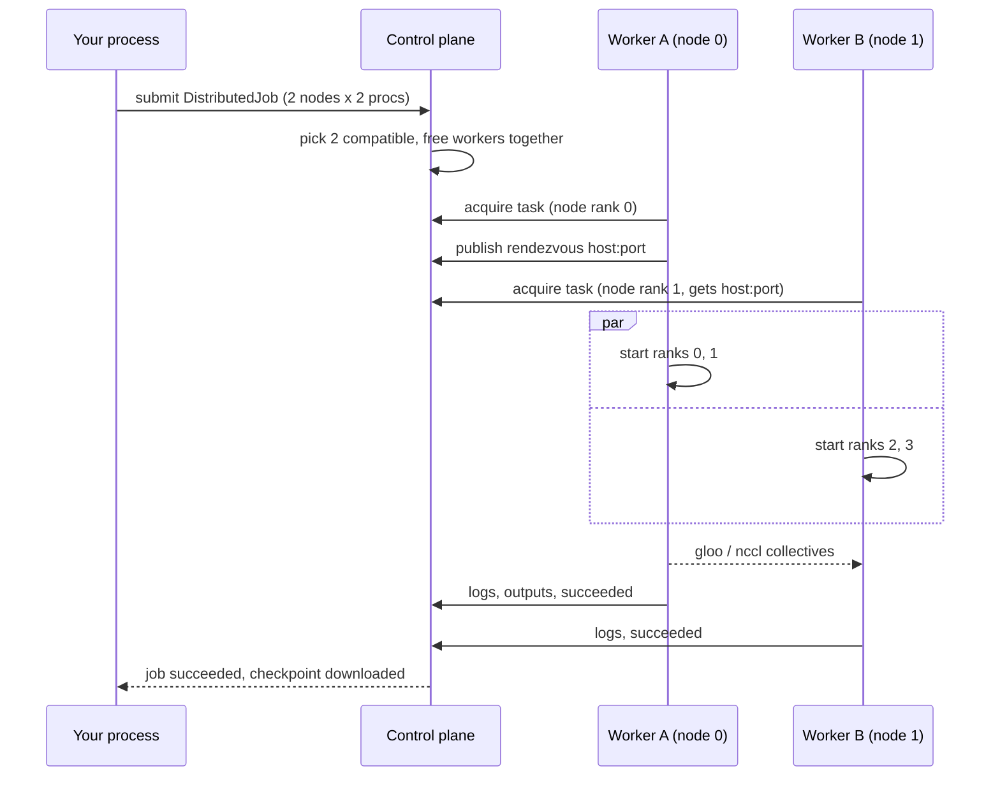

# Distributed training

GPUlayer runs distributed PyTorch with DistributedDataParallel. It finds a group of compatible
workers, assigns ranks, publishes the rendezvous address and starts every process, with the
same environment torchrun would give it.
PyTorch does the gradient communication.

## With the Trainer

```python
trainer = glt.Trainer(max_epochs=10, accelerator="cpu", devices=2)                  # 2 processes, this machine
trainer = glt.Trainer(max_epochs=10, accelerator="cpu", devices=2, num_nodes=2)     # 2 workers x 2
trainer = glt.Trainer(max_epochs=10, accelerator="cuda", devices=8, num_nodes=4,
                      target="remote")                                              # 32 GPUs
trainer.fit(model, train_loader, val_loader)
```

On each process the Trainer:

1. initialises the process group (`gloo` for CPU, `nccl` for CUDA);
2. wraps the training step in `DistributedDataParallel`, so gradients are averaged across all
   processes;
3. replaces the sampler of your `DataLoader` with a `DistributedSampler`, so each process sees
   its own shard (shuffled if your loader shuffled, in order otherwise) and reshuffles every
   epoch;
4. averages logged metrics across processes;
5. saves checkpoints from global rank 0 only.

Your `Module` stays the same as for single-device training.

## What happens when you submit



Node rank `r` hosts global ranks `r * devices` to `(r + 1) * devices - 1`. If any node fails or
loses its worker, the whole job fails and the other nodes are stopped; a partly finished group
is never retried automatically.

## Requirements

- All nodes need the same torch version (the scheduler only groups matching workers) and the
  requested backend (`gloo` or `nccl`).
- With more than one node, each worker needs an address the others can reach:
  `gpulayer worker start --advertise-address 10.0.0.21`. Firewalls must allow node-to-node
  traffic on the rendezvous port and the ports gloo or NCCL open. Pick the network interface with
  `GLOO_SOCKET_IFNAME` / `NCCL_SOCKET_IFNAME` through `launch_options={"env": {...}}`.
- MPS is single-process only. Use CPU or CUDA for distributed training.

## Your own DDP code

If you already have a DDP script, run it unchanged with [`launch()`](launch.md):

```python
import gpulayer.pytorch as glt
glt.launch(nodes=2, devices=4, accelerator="cuda", target="remote")

# your existing script: dist.init_process_group(...), DDP(model), DistributedSampler, ...
```

[`examples/launch_ddp_script/train_ddp.py`](../../examples/launch_ddp_script/train_ddp.py) is such a script.

## What has been tested

| Scenario | Status |
|---|---|
| 1 node x 2 processes, 2 nodes x 2 processes, CPU/gloo, one machine | tested end to end |
| A failing rank fails the job and stops the other node | tested |
| Nodes on different machines | not validated yet |
| NCCL on NVIDIA GPUs | implemented, not validated on hardware yet |
