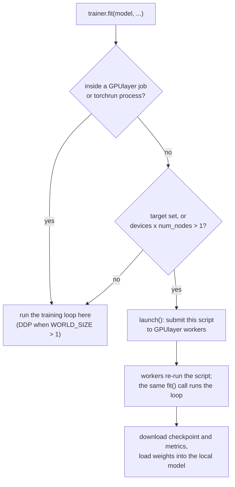

# Trainer and Module

`gpulayer.pytorch` gives you a training API with PyTorch Lightning's names: put the model and
its training logic in a `Module`, and let a `Trainer` run the loop. The `Trainer` also decides
where the loop runs. Code written for Lightning usually moves with an import change; see
[Moving from Lightning](#moving-from-lightning).

```python
import torch
from torch import nn
import gpulayer.pytorch as glt


class Classifier(glt.Module):
    def __init__(self, lr: float = 1e-3):
        super().__init__()
        self.lr = lr
        self.net = nn.Sequential(nn.Flatten(), nn.Linear(28 * 28, 128), nn.ReLU(), nn.Linear(128, 10))

    def forward(self, x):
        return self.net(x)

    def training_step(self, batch, batch_idx):
        x, y = batch
        loss = nn.functional.cross_entropy(self(x), y)
        self.log("train_loss", loss)
        return loss

    def validation_step(self, batch, batch_idx):
        x, y = batch
        logits = self(x)
        self.log("val_loss", nn.functional.cross_entropy(logits, y))
        self.log("val_acc", (logits.argmax(1) == y).float().mean())

    def configure_optimizers(self):
        return torch.optim.Adam(self.parameters(), lr=self.lr)


if __name__ == "__main__":
    model = Classifier()
    trainer = glt.Trainer(max_epochs=10, accelerator="auto")
    trainer.fit(model, train_loader, val_loader)
    print(trainer.callback_metrics)
```

## Module

`glt.Module` (also `glt.LightningModule`) is an `nn.Module` with these methods:

| Method | Required | What to return |
|---|---|---|
| `training_step(batch, batch_idx)` | yes | the loss tensor, or a dict with `"loss"`; `None` skips the batch |
| `validation_step`, `test_step`, `predict_step` | no | nothing (call `self.log`); `predict_step` returns the prediction |
| `configure_optimizers()` | yes | see [Optimizers and schedulers](#optimizers-and-schedulers) |

`self.log(name, value)` records a scalar (a float or a tensor). The Trainer aggregates each
logged name over the steps of an epoch (`reduce_fx="mean"` by default; also `"sum"`, `"max"`,
`"min"`; a mean is weighted by `batch_size=` when you pass it) and averages it across
processes, then stores the result in `trainer.callback_metrics` and `trainer.history`.
`prog_bar=True` shows it in the progress bar; `on_step=False` keeps it out of the per-step
rows; `sync_dist` is accepted (epoch values are always combined across processes). If
`training_step` logs nothing, the Trainer logs the returned loss as `train_loss`.
`self.log_dict({...})` logs several values. Values logged in `on_train_epoch_end` or
`on_validation_epoch_end` are added to that epoch's metrics.

Batches arrive on the right device already. The Trainer moves tensors, and lists, tuples and
dicts of tensors, before calling your step; override `transfer_batch_to_device`,
`on_before_batch_transfer` or `on_after_batch_transfer` for other batch types.

Also on the Module, as in Lightning:

- **Hooks**: `setup(stage)`, `teardown(stage)`, `prepare_data()`, `configure_model()`,
  `on_fit_start/end`, `on_train_start/end`, `on_train_epoch_start/end`,
  `on_train_batch_start` (return `-1` to end the epoch), `on_train_batch_end`,
  `on_before_backward`, `on_after_backward`, `on_before_optimizer_step`,
  `on_before_zero_grad`, the `on_validation_*`, `on_test_*` and `on_predict_*` hooks,
  `on_save_checkpoint(checkpoint)`, `on_load_checkpoint(checkpoint)`, `on_exception`. Only
  hooks you override are called.
- **Hyperparameters**: `self.save_hyperparameters()` in `__init__` records the arguments as
  `self.hparams`; they are saved in checkpoints and loggers, and
  `MyModel.load_from_checkpoint(path)` rebuilds the model from them without arguments.
- **Loaders on the model**: `train_dataloader()`, `val_dataloader()`, `test_dataloader()`,
  `predict_dataloader()` are used when `fit`/`test` get no loaders.
- **Helpers**: `self.print` (rank 0), `self.all_gather(tensor)`, `self.current_epoch`,
  `self.global_step`, `self.global_rank`, `self.device`, `freeze()`/`unfreeze()`,
  `configure_callbacks()`, `to_onnx(path, input_sample)` and `to_torchscript()` (TorchScript
  is deprecated by PyTorch 2.15).

### Manual optimization

Set `self.automatic_optimization = False` to step the optimizers yourself, for GANs or
several optimizers:

```python
def training_step(self, batch, batch_idx):
    opt_g, opt_d = self.optimizers()
    loss_d = ...
    opt_d.zero_grad()
    self.manual_backward(loss_d)      # scales the loss with 16-mixed; syncs DDP gradients
    self.clip_gradients(opt_d, gradient_clip_val=1.0)
    opt_d.step()                       # counts toward trainer.global_step
    ...
```

`toggle_optimizer(opt)`/`untoggle_optimizer(opt)` turn gradients off for the other
optimizers' parameters. Tested in one process and with DDP on two processes.

## DataModule

`glt.DataModule` (also `glt.LightningDataModule`) keeps a project's data in one place:

```python
class MNIST(glt.DataModule):
    def __init__(self, batch_size=64):
        super().__init__()
        self.batch_size = batch_size
    def prepare_data(self):            # once per machine: download here
        datasets.MNIST("data", download=True)
    def setup(self, stage):            # in every process
        self.train_set = datasets.MNIST("data", transform=ToTensor())
    def train_dataloader(self):
        return DataLoader(self.train_set, batch_size=self.batch_size, shuffle=True)

trainer.fit(model, datamodule=MNIST())
```

The Trainer calls it only in the processes that train, so a launched job does not build its
data in the launching process. `DataModule.from_datasets(train, val, batch_size=64)` builds one
from datasets.

## Trainer arguments

| Argument | Default | Meaning |
|---|---|---|
| `max_epochs` | `1` | number of epochs (Lightning's default is 1000; `None` or `-1` means 1000) |
| `min_epochs`, `min_steps` | `None` | train at least this long; early stopping waits until then |
| `max_steps` | `None` | stop after this many optimizer steps, even mid-epoch (`-1`: no limit) |
| `max_time` | `None` | stop after this long: seconds, a `timedelta`, a dict or `"DD:HH:MM:SS"`; checked every step in one process, at the end of each epoch when distributed (so all processes stop together) |
| `check_val_every_n_epoch` | `1` | validate every N epochs (and always after the last one) |
| `val_check_interval` | `None` | also validate within an epoch: every N batches (int) or every fraction of the epoch (float, e.g. `0.25`); results go to `trainer.val_history` |
| `accelerator` | `"auto"` | `"cpu"`, `"cuda"`, `"mps"`, `"rocm"` or `"auto"` (the device granted to the job, else CUDA, then MPS, then CPU) |
| `devices` | `1` | processes per node; with CUDA, one GPU per process. `"auto"` or `-1`: every GPU of this machine |
| `num_nodes` | `1` | number of workers for a distributed run |
| `strategy` | `"ddp"` | `"ddp"`, `"ddp_find_unused_parameters_true"`, `glt.DDPStrategy(find_unused_parameters=, static_graph=, gradient_as_bucket_view=, **ddp_kwargs)`, or `"fsdp"` (experimental); see [FSDP](#fsdp-experimental) |
| `precision` | `"32-true"` | `"32-true"`, `"bf16-mixed"` (CUDA, CPU), `"16-mixed"` (CUDA, with a gradient scaler), or `"bf16-true"`, `"16-true"`, `"64-true"`, which keep the weights and inputs in that dtype; Lightning's short forms `32`, `"16"`, `"bf16"`, `64` are accepted |
| `sync_batchnorm` | `False` | BatchNorm statistics over all processes (`SyncBatchNorm`; CUDA or ROCm only) |
| `target` | `None` | `None` runs here when possible; `"local"`, `"remote"` or `"cloud"` always submits a job |
| `gradient_clip_val` | `None` | clip gradients to this value |
| `gradient_clip_algorithm` | `"norm"` | `"norm"` clips the total gradient norm; `"value"` clips each gradient value to `[-v, v]` |
| `gradient_sync` | `"auto"` | with gloo and several processes per machine, sum gradients inside each machine before crossing the network (ADR-0020); `"flat"` or `"two_level"` to choose |
| `accumulate_grad_batches` | `1` | apply the optimizer every N batches; DDP exchanges gradients only on those steps |
| `callbacks` | `[]` | `Callback` objects, see [Callbacks](#callbacks) |
| `logger` | `None` | `None`/`True`: the built-in `metrics.csv`; `False`: none; a `Logger` or a list, see [Loggers](#loggers-and-profilers) |
| `profiler` | `None` | `"simple"`, `"advanced"`, `"pytorch"` or a `Profiler` |
| `log_every_n_steps` | `50` | print logged values every N steps (`0` turns it off) |
| `limit_train_batches`, `limit_val_batches`, `limit_test_batches`, `limit_predict_batches` | `None` | use N batches (int) or a fraction of the loader (float) |
| `overfit_batches` | `0` | train and validate on the same first N batches (int) or fraction, without shuffling |
| `reload_dataloaders_every_n_epochs` | `0` | build the training loader again every N epochs (give it as a function or DataModule) |
| `use_distributed_sampler` | `True` | give each process its shard with a `DistributedSampler`; `False` uses your loader as it is |
| `num_sanity_val_steps` | `2` | run N validation batches before training, so a broken `validation_step` fails at once (skipped when resuming; `0` off, `-1` all) |
| `fast_dev_run` | `False` | `True` or N: one epoch of N training and N validation batches, no checkpoints, to check the whole pipeline quickly |
| `inference_mode` | `True` | `torch.inference_mode` in `validate`, `test` and `predict` (faster than `no_grad`); validation inside `fit`, gloo and FSDP use `no_grad`, as in Lightning |
| `deterministic` | `False` | use deterministic algorithms (with `seed_everything(n)`, runs repeat exactly; usually slower); `"warn"` only warns about non-deterministic operations |
| `detect_anomaly` | `False` | `torch.autograd` anomaly detection (slow; for finding NaN sources) |
| `benchmark` | `None` | cuDNN autotuning (`torch.backends.cudnn.benchmark`) on CUDA. `None`: on for runs that plan at least 1,000 steps (it costs 1 to 3 s at the start and made CNN steps 5 to 9% faster), off for shorter runs and with `deterministic`. `True` or `False` force it. Lightning leaves it off by default |
| `prefetch` | `False` | on CUDA, a background thread loads and pins the next batches and each is copied to the GPU on a side stream while the current step runs. Helps compute-heavy models (a CNN 5% faster per step on an RTX 3070); slows short steps, where the thread competes with the training loop for the Python interpreter (an MLP 36% slower), so it is off by default |
| `enable_checkpointing` | `True` | save `checkpoints/last.ckpt` after every epoch |
| `enable_progress_bar` | `False` | a progress line per epoch on a terminal (Lightning's default is `True`; GPUlayer prints one line per epoch, and job logs are not terminals) |
| `enable_model_summary` | `False` | print the layers and parameter counts at the start (Lightning's default is `True`) |
| `barebones` | `False` | turn off everything that may cost speed: checkpoints, logging, summaries, progress bar, sanity check |
| `default_root_dir` | `"gpulayer_runs"` | where local checkpoints and downloaded job outputs go |
| `launch_options` | `{}` | extra arguments for [`launch()`](launch.md), for example `{"env": {...}, "timeout_seconds": 3600}` |

A model passed through `torch.compile(model, ...)` trains compiled, with the options it was
compiled with (tested with `backend="eager"` on CPU; Inductor on a GPU is not validated yet).

Unsupported combinations fail with an error instead of quietly doing something else. Examples:
`precision="16-mixed"` on MPS, `accelerator="cuda"` on a machine without CUDA, `devices=2` with
MPS, `sync_batchnorm=True` on CPU processes, `plugins=...`, or `accelerator="auto"` with
`target="remote"` (the remote device is unknown until the
job is placed, so name it).


## Optimizers and schedulers

`configure_optimizers` may return any of Lightning's forms:

```python
return torch.optim.AdamW(self.parameters(), lr=1e-3)
return [opt_g, opt_d]                                  # manual optimization only
return [opt], [scheduler]
return {"optimizer": opt, "lr_scheduler": {"scheduler": sched, "interval": "step", "frequency": 1}}
return {"optimizer": opt, "lr_scheduler": ReduceLROnPlateau(opt), "monitor": "val_loss"}
```

Epoch schedulers step at the end of each epoch; `ReduceLROnPlateau` steps after validation
with the monitored value. Override `optimizer_step`, `optimizer_zero_grad`,
`lr_scheduler_step` or `configure_gradient_clipping` on the Module to change those steps (for
example a warm-up). Several optimizers need manual optimization, as in Lightning.

## Callbacks

Callbacks hook into the training loop and have Lightning's names and signatures:

```python
from gpulayer.pytorch import EarlyStopping, ModelCheckpoint, Trainer

best = ModelCheckpoint(monitor="val_loss", filename="{epoch}-{val_loss:.3f}", save_top_k=3)
trainer = Trainer(max_epochs=50, callbacks=[EarlyStopping(monitor="val_loss", patience=3), best])
trainer.fit(model, train_loader, val_loader)
model = MyModel.load_from_checkpoint(best.best_model_path)
trainer.test(model, test_loader, ckpt_path="best")
```

| Callback | What it does |
|---|---|
| `ModelCheckpoint(dirpath, filename, monitor, save_top_k, save_last, every_n_train_steps, every_n_epochs, train_time_interval, save_weights_only, mode)` | keeps the best checkpoints by `monitor` (`monitor=None`: the latest). `filename` is `best.ckpt` by default or a template such as `"{epoch}-{val_loss:.2f}"`; `save_top_k=-1` keeps all, `0` none. `best_model_path`, `best_model_score`, `best_k_models`, `last_model_path` afterwards, also when training ran on workers |
| `EarlyStopping(monitor, min_delta, patience, mode, strict, check_finite, stopping_threshold, divergence_threshold)` | stops when the metric stops improving, reaches a threshold or becomes NaN |
| `LearningRateMonitor(logging_interval, log_momentum, log_weight_decay)` | records `lr` (or `lr-<i>` per group) per epoch, or per logged step with `"step"` |
| `Timer(duration, interval)` | stops after a duration; `time_elapsed()`, `time_remaining()` |
| `GradientAccumulationScheduler({0: 8, 4: 4})` | changes `accumulate_grad_batches` by epoch |
| `StochasticWeightAveraging(swa_lrs, swa_epoch_start)` | SWA with `SWALR`; recomputes BatchNorm statistics at the end |
| `EMAWeightAveraging(decay)`, `WeightAveraging(...)` | an average of the weights (one fused multi-tensor update per step), used for validation and left in the model and checkpoints |
| `BackboneFinetuning(unfreeze_backbone_at_epoch)`, `BaseFinetuning` | freeze `model.backbone`, then unfreeze it with its own learning rate |
| `ModelPruning(pruning_fn, amount)` | `torch.nn.utils.prune` at epoch ends; plain weights in checkpoints |
| `ThroughputMonitor(batch_size_fn, length_fn)` | samples, batches or tokens per second on logged steps, timed on the host (no device sync) |
| `DeviceStatsMonitor()` | CUDA or MPS memory (and CPU with `psutil`) on logged steps |
| `SpikeDetection(window, rtol)` | raises `TrainingSpikeException` when the loss jumps (reads the loss every step; for debugging) |
| `ModelSummary(max_depth)` | prints layers and parameter counts |
| `ProgressBar()` (`TQDMProgressBar`) | a progress line per epoch on a terminal (uses `tqdm` when installed) |
| `BasePredictionWriter(write_interval)` | writes predictions per batch or epoch instead of keeping them |
| `OnExceptionCheckpoint(dirpath)` | saves a checkpoint when training stops with an error or Ctrl+C (one process) |
| `LambdaCallback(on_train_epoch_end=...)` | a callback from functions |
| `LearningRateFinder()`, `BatchSizeFinder()` | run the [Tuner](#tuner) when `fit` starts (one process) |

Write your own by subclassing `Callback` and overriding any Lightning hook, for example
`on_train_batch_end(trainer, pl_module, outputs, batch, batch_idx)`; `state_dict` and
`load_state_dict` are saved in checkpoints. Callbacks written for GPUlayer 0.7 with
`on_train_batch_end(trainer, model, loss, batch_idx)` still work. Set
`trainer.should_stop = True` to end training; `trainer.save_checkpoint("name.ckpt")` writes a
checkpoint. The monitored name must be logged with `self.log(...)`; otherwise the error lists
the names that were logged.

In distributed runs callbacks run on every rank. Epoch metrics are averaged across ranks
first, and if any rank sets `should_stop`, every rank stops after the same epoch. When
`fit` launches training on workers, the callbacks run there; in the launching process only
`on_fit_end` runs.

## Loggers and profilers

```python
trainer = glt.Trainer(logger=[glt.CSVLogger("logs"), glt.TensorBoardLogger("tb")],
                      profiler="simple")
```

`CSVLogger`, `TensorBoardLogger`, `WandbLogger` and `MLFlowLogger` receive the hyperparameters,
the values of each logged step and each epoch's metrics, from rank 0. They are given values the
Trainer already read for its log line, so they add no device synchronisation. TensorBoard,
Weights & Biases and MLflow need their packages installed (only `CSVLogger` is tested in CI).

`profiler="simple"` prints the time of each loop action (data loading, training batch,
backward, optimizer step, validation) at the end; `"advanced"` adds `cProfile` per action;
`"pytorch"` (`glt.PyTorchProfiler(export_to_chrome=True)`) records operators with
`torch.profiler`. Without a profiler the loop has no profiling code on its path.

## Tuner

```python
tuner = glt.Tuner(trainer)
finder = tuner.lr_find(model, train_loader)        # sets model.lr (or hparams.lr)
size = tuner.scale_batch_size(model, datamodule=dm)  # sets dm.batch_size
```

`lr_find` trains a few steps with a rising learning rate and suggests the rate where the loss
falls fastest; `scale_batch_size` doubles the batch size until a step runs out of memory
(`mode="binsearch"` then narrows it down). Both run in this process and restore the weights.

## Where `fit` runs



When `fit` submits a job, it re-runs your script on the workers with the same command-line
arguments. On the workers, the same `fit` call runs the training loop. When the job finishes,
the launching process downloads the outputs and loads the final weights into your local
`model`. Code after `fit` therefore sees a trained model in both cases.

Because the script runs again on the workers, code at module level and after `fit` runs there
too. Guard work that should only happen once, on your machine:

```python
trainer.fit(model, train_loader, val_loader)
if glt.is_launcher_process():
    torch.save(model.state_dict(), "final.pt")
```

## After training

| Attribute | Contents |
|---|---|
| `trainer.callback_metrics` | metrics of the last epoch, e.g. `{"train_loss": 0.1, "val_loss": 0.08, ...}` |
| `trainer.history` | one dict per epoch |
| `trainer.checkpoint_path` | path of `last.ckpt` (downloaded, for a submitted job) |
| `trainer.launch_result` | the `LaunchResult` of a submitted job (job id, status, output files) |
| `trainer.global_step`, `trainer.current_epoch` | progress counters |
| `trainer.logged_metrics`, `trainer.progress_bar_metrics` | values of the last logged step |
| `trainer.checkpoint_callback`, `trainer.early_stopping_callback` | the first of each, if any |
| `trainer.estimated_stepping_batches`, `trainer.num_training_batches` | planned optimizer steps, batches per epoch |
| `trainer.interrupted` | `True` when Ctrl+C ended `fit` (it returns normally, as in Lightning) |

## Checkpoints and resuming

With checkpointing on, global rank 0 writes `checkpoints/last.ckpt`, `metrics.json` and
`metrics.csv` after every epoch. `metrics.csv` has a row per printed step (every
`log_every_n_steps`), per validation within an epoch and per epoch, with a `kind` column. Inside a job they go to `$GPULAYER_OUTPUT_DIR` and come back as artifacts
(`gpulayer_runs/<job-id>/...`); in-process they go to `gpulayer_runs/<directory>-<script>/`,
for example `gpulayer_runs/my_project-train/` for `my_project/train.py`.

```python
model = Classifier.load_from_checkpoint("gpulayer_runs/my_project-train/checkpoints/last.ckpt")
trainer = glt.Trainer(max_epochs=20)
trainer.fit(model, train_loader, val_loader,
            ckpt_path="gpulayer_runs/my_project-train/checkpoints/last.ckpt")
```

A checkpoint holds `state_dict`, `optimizer_states`, `lr_schedulers`, `callbacks` (each
callback's state), `hyper_parameters`, the gradient scaler, `epoch`, `global_step` and
`history`, in Lightning's layout. `ckpt_path` restores all of them and continues from the next
epoch; a checkpoint saved within an epoch (`every_n_train_steps`) continues in that epoch,
skipping the batches already trained. When `fit` launches
training on workers, a local `ckpt_path` is uploaded with the job, so resuming works the same
way remotely.

## Build data where training runs

When the Trainer launches a job (several GPUs or machines, or `target`), the launching process
only submits it and waits; the job runs the script again in each process. Data built before
`fit()` in the launching process is thrown away. Pass a function instead and it is called only
where training runs:

```python
def train_loader():
    return DataLoader(make_dataset(), batch_size=128, shuffle=True)

trainer.fit(model, train_loader)          # not train_loader()
```

The same works for `val_dataloaders`, `validate`, `test` and `predict`, and a
[DataModule](#datamodule) or the model's `train_dataloader()` is built only where training runs
too.

## FSDP (experimental)

`strategy="fsdp"` shards each submodule that owns parameters (for example every `nn.Linear`)
across the processes with PyTorch's FSDP2 (`fully_shard`), so each process holds about
1/N of the parameters, gradients and optimizer state. Each layer's parameters are gathered
only while it runs.

```python
trainer = glt.Trainer(accelerator="cuda", devices=8, num_nodes=2, strategy="fsdp",
                      precision="bf16-mixed")
```

- The Module's parameters must live in submodules, not as `nn.Parameter` attributes of the
  Module itself.
- Checkpoints are gathered into a full, unsharded state dict, so `load_from_checkpoint` and
  `ckpt_path` work as with DDP.
- Precision `32-true` and `bf16-mixed`; `16-mixed` is rejected for now.
- Tested with two CPU processes (gloo): FSDP trains exactly like DDP (identical losses), each
  process holds a part of the model, and a run resumes from its checkpoint. It has not been
  run on CUDA GPUs yet.

## Validate, test and predict

```python
metrics = trainer.validate(model, val_loader)   # {"val_loss": ..., "val_acc": ...}
metrics = trainer.test(model, test_loader)      # runs Module.test_step: {"test_acc": ...}
metrics = trainer.test(ckpt_path="best", datamodule=dm)
outputs = trainer.predict(model, loader)        # one output per batch, on the CPU
```

The results are a dict that also answers `metrics[0]`, Lightning's list form. `predict` calls
`Module.predict_step(batch, batch_idx)`, which by default returns `self(batch)` (or
`self(batch[0])` for an `(inputs, targets)` batch). All three run in the current process with
the Trainer's precision, under `torch.inference_mode` (`inference_mode=False` for `no_grad`).
`ckpt_path` is a path, `"best"` (the `ModelCheckpoint`'s best) or `"last"`.

## Moving from Lightning

```python
import gpulayer.pytorch as glt              # instead of: import lightning as L

class Model(glt.LightningModule): ...       # glt.Module is the same class
trainer = glt.Trainer(max_epochs=10, accelerator="cuda", devices=4, num_nodes=2)
```

Differences to know:

- Defaults: `max_epochs=1`, `enable_progress_bar=False`, `enable_model_summary=False`,
  `benchmark=None` (on for long CUDA runs). Pass Lightning's values to get its behaviour.
- `ModelCheckpoint` keeps `best.ckpt` by default (Lightning: `epoch=..-step=...ckpt`); give
  `filename="{epoch}-{step}"` for Lightning's names.
- `validate`/`test` return a dict (that also answers `[0]`), and `fit` returns after Ctrl+C.
- Not available: DeepSpeed, TPU/HPU/XLA, `plugins=`, `LightningCLI`, several dataloaders per
  stage, distributed `predict`. Keep Lightning for those and run it with
  [`launch()`](launch.md), which gives it the same placement.
- `sync_batchnorm`, 16-mixed with manual optimization, `torch.compile` with Inductor and the
  CUDA tables of `PyTorchProfiler` are implemented and tested on CPU where possible, but not
  yet run on GPUs. FSDP is experimental and CPU-tested.

[ADR-0024](../decisions/ADR-0024-lightning-feature-parity.md) lists what was adopted and why.
