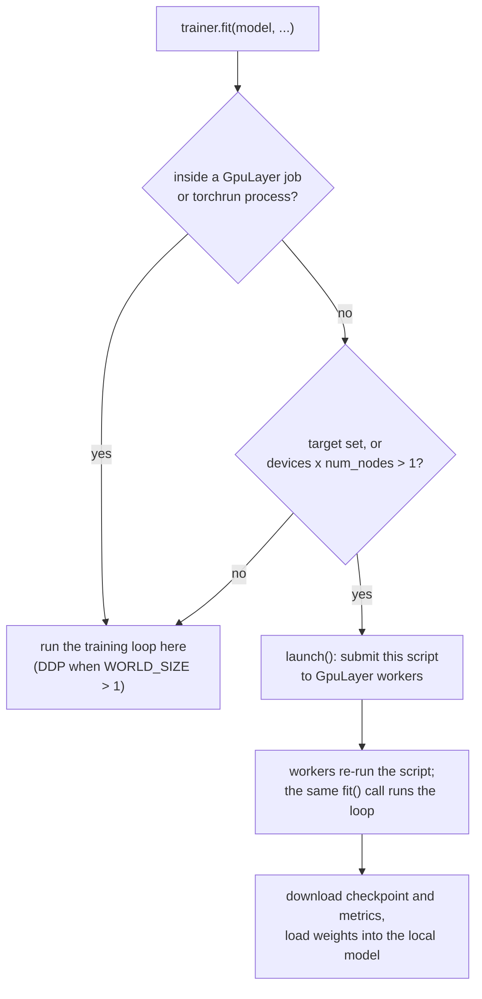

# Trainer and Module

`gpulayer.pytorch` gives you a small training API: put the model and its training logic in a
`Module`, and let a `Trainer` run the loop. The `Trainer` also decides where the loop runs.

```python
import torch
from torch import nn
import gpulayer.pytorch as glt


class Classifier(glt.Module):
    def __init__(self, lr: float = 1e-3):
        super().__init__()
        self.lr = lr
        self.net = nn.Sequential(nn.Flatten(), nn.Linear(28 * 28, 128), nn.ReLU(), nn.Linear(128, 10))

    def forward(self, x):
        return self.net(x)

    def training_step(self, batch, batch_idx):
        x, y = batch
        loss = nn.functional.cross_entropy(self(x), y)
        self.log("train_loss", loss)
        return loss

    def validation_step(self, batch, batch_idx):
        x, y = batch
        logits = self(x)
        self.log("val_loss", nn.functional.cross_entropy(logits, y))
        self.log("val_acc", (logits.argmax(1) == y).float().mean())

    def configure_optimizers(self):
        return torch.optim.Adam(self.parameters(), lr=self.lr)


if __name__ == "__main__":
    model = Classifier()
    trainer = glt.Trainer(max_epochs=10, accelerator="auto")
    trainer.fit(model, train_loader, val_loader)
    print(trainer.callback_metrics)
```

## Module

`glt.Module` is an `nn.Module` with these hooks:

| Hook | Required | What to return |
|---|---|---|
| `training_step(batch, batch_idx)` | yes | the loss tensor |
| `validation_step(batch, batch_idx)` | no | nothing; call `self.log(...)` |
| `configure_optimizers()` | yes | an optimizer, `(optimizer, scheduler)`, or `{"optimizer": ..., "lr_scheduler": ..., "interval": "epoch" or "step"}` |

`self.log(name, value)` records a scalar (a float or a tensor). The Trainer averages each logged
name over the steps of an epoch and across all processes, then stores the result in
`trainer.callback_metrics` and `trainer.history`. If `training_step` logs nothing, the Trainer
logs the returned loss as `train_loss`.

Batches arrive on the right device already. The Trainer moves tensors, and lists, tuples and
dicts of tensors, before calling your step.

## Trainer arguments

| Argument | Default | Meaning |
|---|---|---|
| `max_epochs` | `1` | number of epochs |
| `accelerator` | `"auto"` | `"cpu"`, `"cuda"`, `"mps"` or `"auto"` (the device granted to the job, else CUDA, then MPS, then CPU) |
| `devices` | `1` | processes per node; with CUDA, one GPU per process |
| `num_nodes` | `1` | number of workers for a distributed run |
| `precision` | `"32-true"` | `"32-true"`, `"bf16-mixed"` (CUDA, CPU) or `"16-mixed"` (CUDA, with a gradient scaler) |
| `target` | `None` | `None` runs here when possible; `"local"`, `"remote"` or `"cloud"` always submits a job |
| `gradient_clip_val` | `None` | clip the gradient norm to this value |
| `log_every_n_steps` | `50` | print logged values every N steps (`0` turns it off) |
| `limit_train_batches`, `limit_val_batches` | `None` | stop an epoch after N batches |
| `enable_checkpointing` | `True` | save `checkpoints/last.ckpt` after every epoch |
| `default_root_dir` | `"gpulayer_runs"` | where local checkpoints and downloaded job outputs go |
| `launch_options` | `{}` | extra arguments for [`launch()`](launch.md), for example `{"env": {...}, "timeout_seconds": 3600}` |

Unsupported combinations fail with an error instead of quietly doing something else. Examples:
`precision="16-mixed"` on MPS, `accelerator="cuda"` on a machine without CUDA, `devices=2` with
MPS, or `accelerator="auto"` with `target="remote"` (the remote device is unknown until the
job is placed, so name it).

## Where `fit` runs



When `fit` submits a job, it re-runs your script on the workers with the same command-line
arguments. On the workers, the same `fit` call runs the training loop. When the job finishes,
the launching process downloads the outputs and loads the final weights into your local
`model`. Code after `fit` therefore sees a trained model in both cases.

Because the script runs again on the workers, code at module level and after `fit` runs there
too. Guard work that should only happen once, on your machine:

```python
trainer.fit(model, train_loader, val_loader)
if glt.is_launcher_process():
    torch.save(model.state_dict(), "final.pt")
```

## After training

| Attribute | Contents |
|---|---|
| `trainer.callback_metrics` | metrics of the last epoch, e.g. `{"train_loss": 0.1, "val_loss": 0.08, ...}` |
| `trainer.history` | one dict per epoch |
| `trainer.checkpoint_path` | path of `last.ckpt` (downloaded, for a submitted job) |
| `trainer.launch_result` | the `LaunchResult` of a submitted job (job id, status, output files) |
| `trainer.global_step`, `trainer.current_epoch` | progress counters |

## Checkpoints and resuming

With checkpointing on, global rank 0 writes `checkpoints/last.ckpt` and `metrics.json` after
every epoch. Inside a job they go to `$GPULAYER_OUTPUT_DIR` and come back as artifacts
(`gpulayer_runs/<job-id>/...`); in-process they go to `gpulayer_runs/local/`.

```python
model = Classifier.load_from_checkpoint("gpulayer_runs/local/checkpoints/last.ckpt")
trainer = glt.Trainer(max_epochs=20)
trainer.fit(model, train_loader, val_loader, ckpt_path="gpulayer_runs/local/checkpoints/last.ckpt")
```

A checkpoint holds `state_dict`, `optimizer`, `epoch`, `global_step` and `history`.
`ckpt_path` restores the optimizer and continues from the next epoch.

## Validation only

```python
metrics = trainer.validate(model, val_loader)   # {"val_loss": ..., "val_acc": ...}
```

`validate` runs in the current process.

## What the Trainer does not do yet

Callbacks, early stopping, gradient accumulation, logger integrations and strategies other than
DDP are not implemented. If you need them, keep your existing training code and run it with
[`launch()`](launch.md).
